# Diagramas de Tabloncito 470

Versión 1.1 · 30 de septiembre de 2026 · Basado en lectura del código del repositorio.

Complemento de [DERCAS — Especificación de requisitos de software](DERCAS_ESPECIFICACION_SOFTWARE.md).

## Cómo leer este documento

- **F-nn:** diagrama de flujo, con pasos y decisiones del proceso P-nn.
- **A-nn:** diagrama de actividades con carriles por responsable, representado mediante `flowchart` de Mermaid. Es una representación de actividades; no afirma conformidad completa con la notación UML.
- **S-nn:** diagrama de secuencia, con mensajes ordenados entre participantes.
- **ARQ-01:** arquitectura lógica y dependencias.
- **DEP-01:** despliegue observado en Docker Compose, puertos y persistencia.
- **EST-01:** estados OCR realmente escritos.

Los bloques `mermaid` son editables y se visualizan en un lector Markdown compatible con Mermaid. Los identificadores vinculan cada dibujo con RF-nn y CA-nn.m de la especificación. Los diagramas describen el código actual, incluyendo brechas; no representan correcciones ya implementadas. En secuencias, Backend agrupa rutas, middleware, controladores, servicios y repositorios salvo que se indique lo contrario.

Se presentan **16 procesos principales y 48 diagramas principales**. En procesos con varias operaciones, la decisión inicial del flujo y el bloque alt de secuencia representan acciones alternativas, no una ejecución obligatoria de todas ellas. Cada rama conserva los pasos de su operación. Las consultas y formularios pueden preceder a otra solicitud de modificación. Los diagramas de detalle, arquitectura y despliegue son complementarios y no cuentan como procesos adicionales.

## Índice de procesos

| Proceso | Nombre | Diagramas |
|---|---|---|
| [P-01](#p-01) | Autenticación y cierre de sesión | F-01 / A-01 / S-01 |
| [P-02](#p-02) | Gestión de contraseña personal | F-02 / A-02 / S-02 |
| [P-03](#p-03) | Consulta del panel principal | F-03 / A-03 / S-03 |
| [P-04](#p-04) | Gestión de alumnos | F-04 / A-04 / S-04 |
| [P-05](#p-05) | Gestión de cuadros PRIM | F-05 / A-05 / S-05 |
| [P-06](#p-06) | Consulta y revisión de trabajos OCR | F-06 / A-06 / S-06 |
| [P-07](#p-07) | Carga y procesamiento OCR | F-07 / A-07 / S-07 |
| [P-08](#p-08) | Resolución y reprocesamiento OCR | F-08 / A-08 / S-08 |
| [P-09](#p-09) | Administración de usuarios | F-09 / A-09 / S-09 |
| [P-10](#p-10) | Administración de roles y permisos | F-10 / A-10 / S-10 |
| [P-11](#p-11) | Administración de grados y secciones | F-11 / A-11 / S-11 |
| [P-12](#p-12) | Administración de cursos | F-12 / A-12 / S-12 |
| [P-13](#p-13) | Administración de maestros | F-13 / A-13 / S-13 |
| [P-14](#p-14) | Asignación docente | F-14 / A-14 / S-14 |
| [P-15](#p-15) | Importación masiva de datos | F-15 / A-15 / S-15 |
| [P-16](#p-16) | Promoción de ciclo escolar | F-16 / A-16 / S-16 |

## Control de acceso compartido

Se aplica antes de los pasos de los procesos protegidos. Login, logout y callback son las excepciones descritas en el DERCAS. Una denegación detiene la petición antes de acceder a las operaciones del módulo.

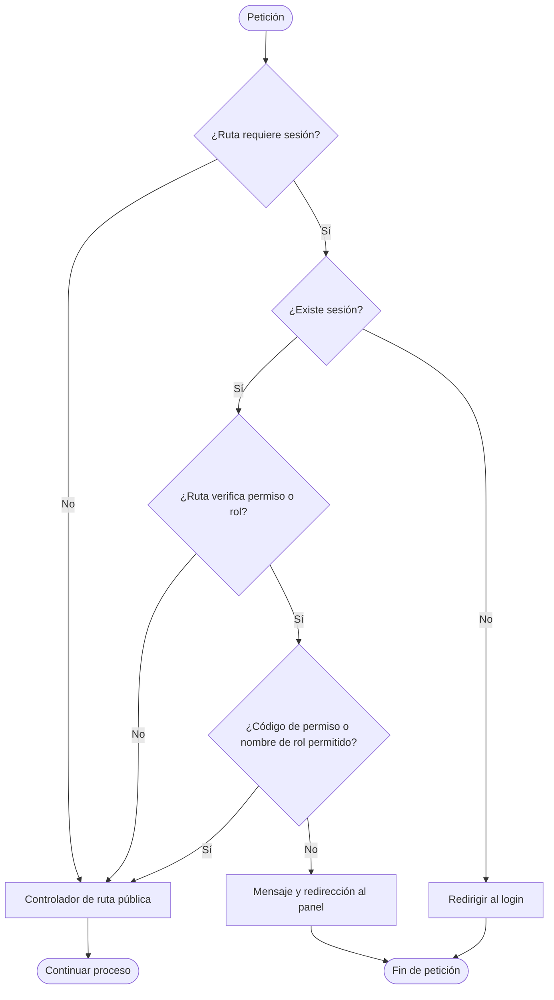

La presencia de un código basta para el middleware actual; este flujo no filtra own o assigned. Las comprobaciones de formularios y errores específicos se detallan en los procesos y en la especificación.

<a id="p-01"></a>

## P-01. Autenticación y cierre de sesión

**Requisito:** RF-01. Los criterios de aceptación CA-01.m y los pasos completos se encuentran en el DERCAS.

| Subactividad | Acceso | Resultado y limitaciones |
|---|---|---|
| 1.1. Iniciar sesión | Acceso público | Sesión creada y redirección a /dashboard. Campos vacíos, usuario inactivo o contraseña incorrecta: mensaje y retorno al login; si ya existe sesión, GET redirige al panel. |
| 1.2. Cerrar sesión | Sin middleware de autenticación en esta ruta | Sesión destruida. La función redirige desde el callback de destrucción; no presenta un manejo específico de error. |

### F-01. Flujo

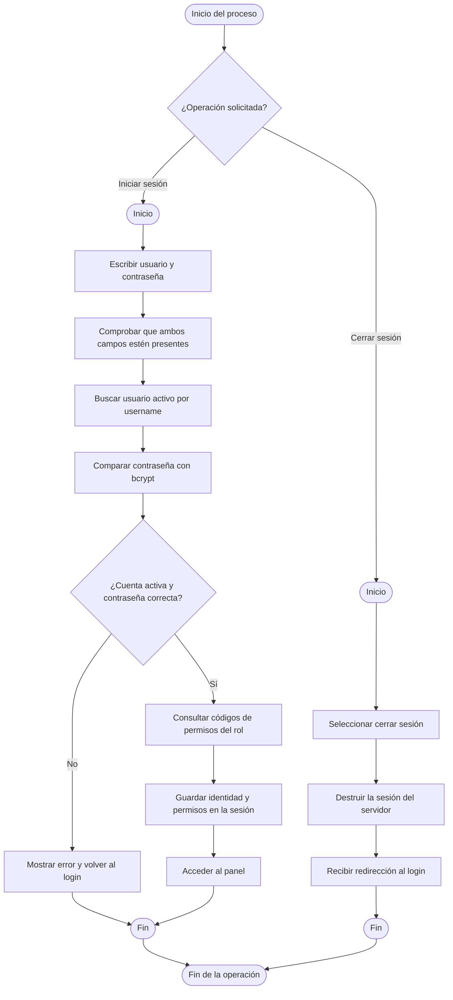

### A-01. Actividades por responsable

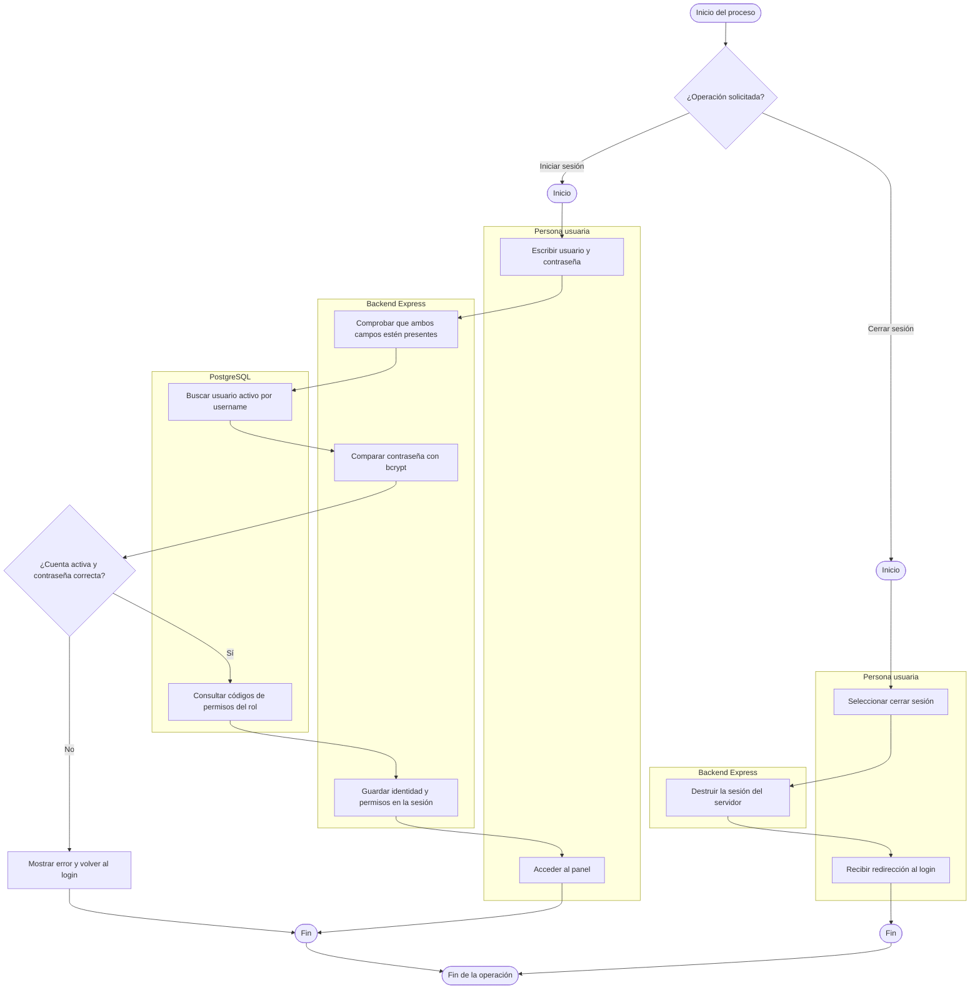

### S-01. Secuencia

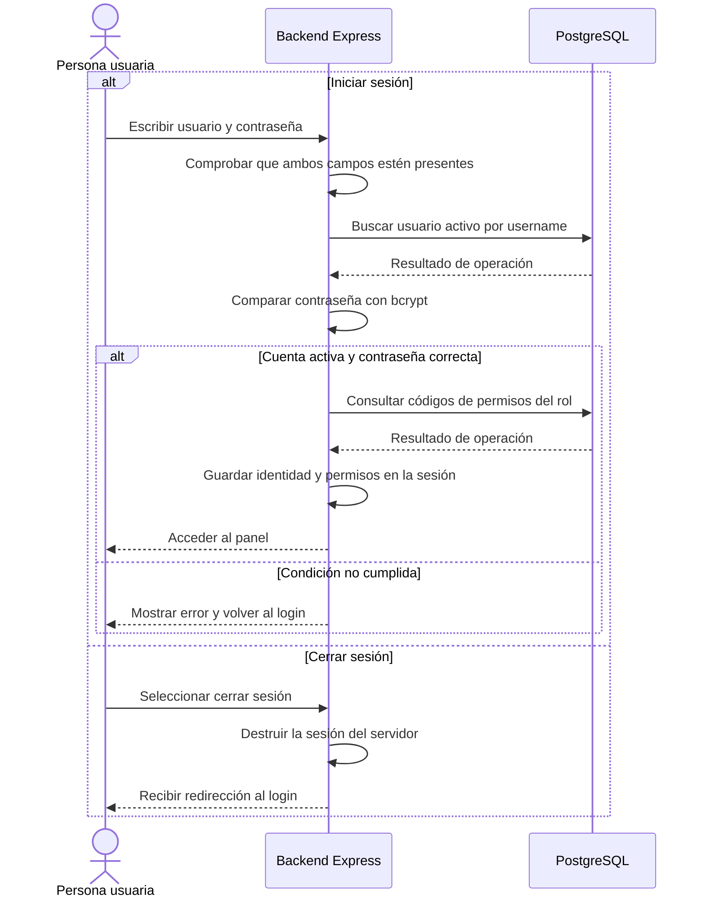

<a id="p-02"></a>

## P-02. Gestión de contraseña personal

**Requisito:** RF-02. Los criterios de aceptación CA-02.m y los pasos completos se encuentran en el DERCAS.

| Subactividad | Acceso | Resultado y limitaciones |
|---|---|---|
| 2.1. Cambiar contraseña propia | Sesión autenticada | Contraseña sustituida si la actual coincide. Contraseña actual incorrecta: no actualizar; no hay política de complejidad implementada en el servicio. |

### F-02. Flujo

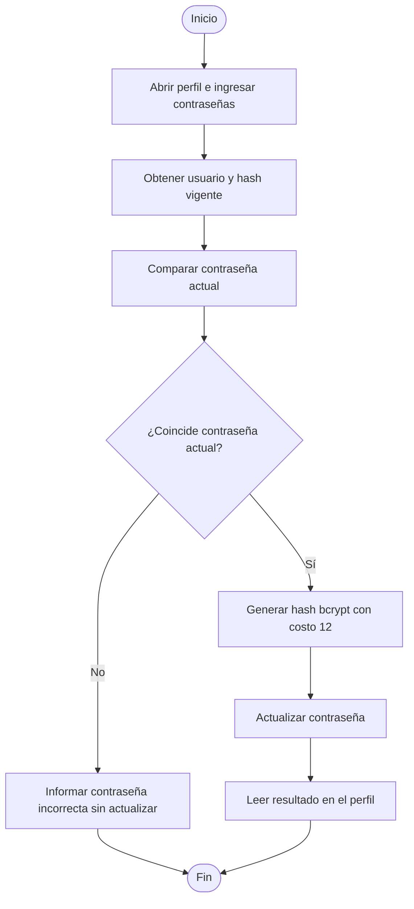

### A-02. Actividades por responsable

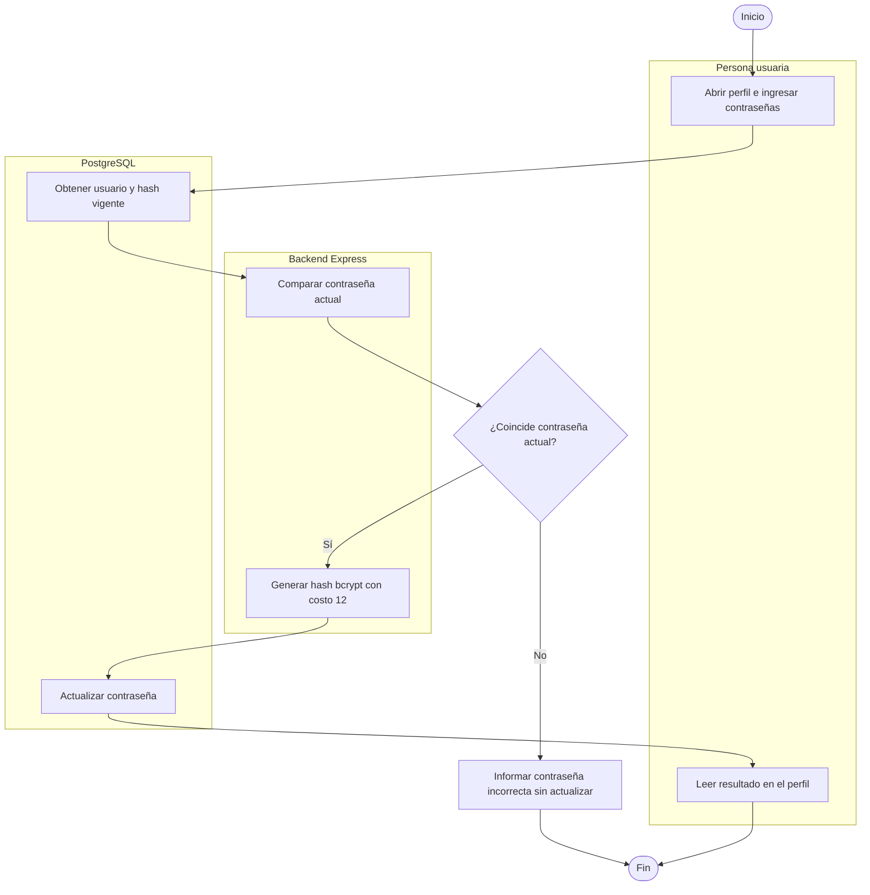

### S-02. Secuencia

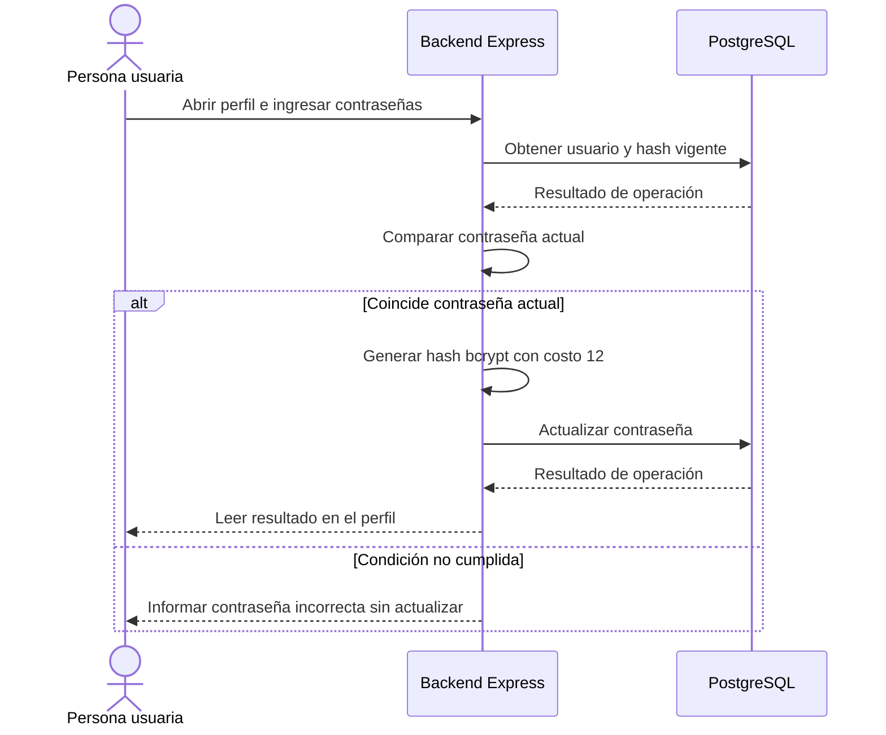

<a id="p-03"></a>

## P-03. Consulta del panel principal

**Requisito:** RF-03. Los criterios de aceptación CA-03.m y los pasos completos se encuentran en el DERCAS.

| Subactividad | Acceso | Resultado y limitaciones |
|---|---|---|
| 3.1. Consultar panel principal | Sesión autenticada | Indicadores y cuadros recientes visibles. La ruta no comprueba dashboard.view; los contadores de alumnos incluyen inactivos no eliminados. |

### F-03. Flujo

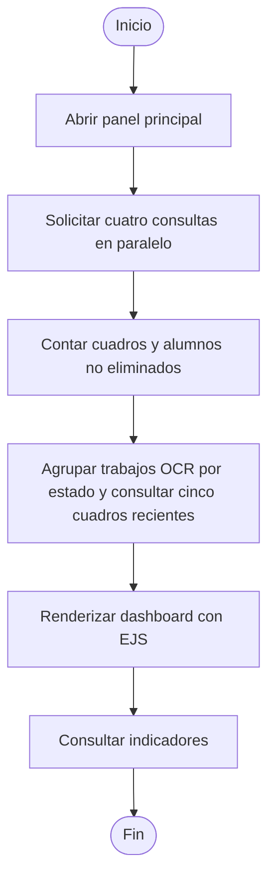

### A-03. Actividades por responsable

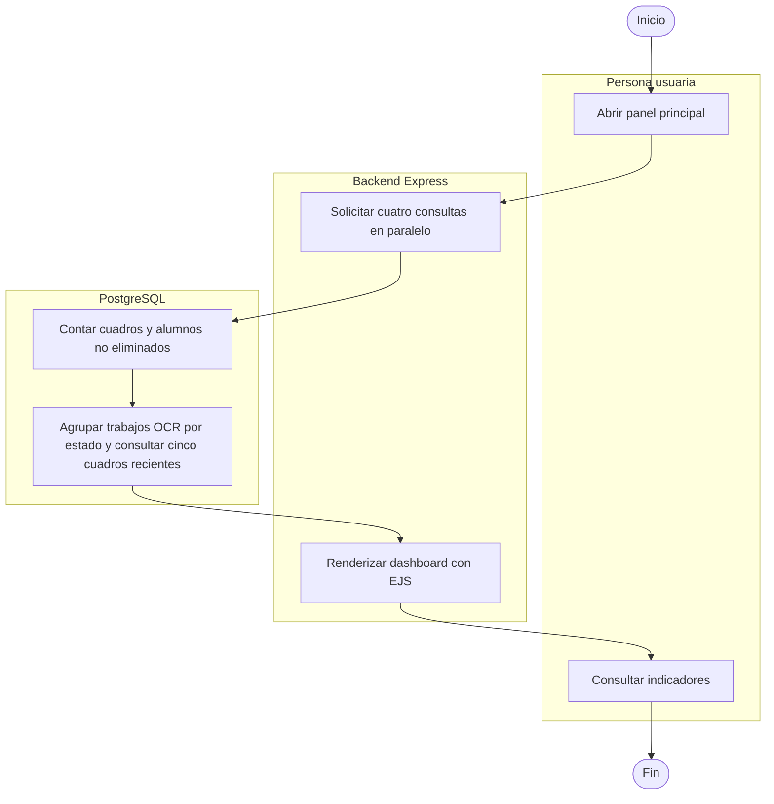

### S-03. Secuencia

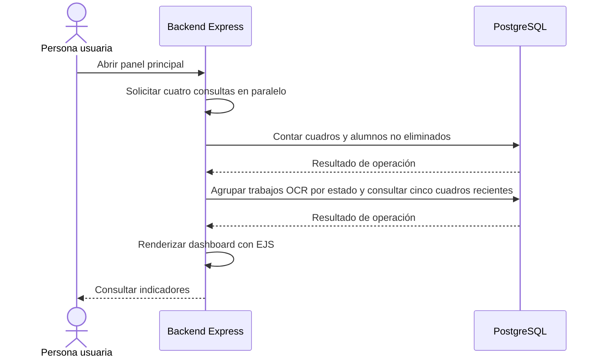

<a id="p-04"></a>

## P-04. Gestión de alumnos

**Requisito:** RF-04. Los criterios de aceptación CA-04.m y los pasos completos se encuentran en el DERCAS.

| Subactividad | Acceso | Resultado y limitaciones |
|---|---|---|
| 4.1. Consultar y buscar alumnos | students.view | Lista de 10 o 20 registros por página, o detalle del alumno. Un detalle inexistente redirige al listado. Con filtros, el total se calcula con la página devuelta y puede subestimar resultados. |
| 4.2. Registrar alumno | students.create | Alumno registrado con is_active verdadero por defecto. Si falla la inserción, mostrar error y volver al formulario; CUI no tiene restricción UNIQUE. |
| 4.3. Editar alumno | students.create | Datos actualizados. GET de alumno inexistente redirige al listado; error de escritura regresa a edición. |
| 4.4. Activar o desactivar alumno | students.create | Estado activo invertido sin eliminar datos. La consulta SQL no verifica filas afectadas; los alumnos inactivos siguen en listados y en la promoción actual. |
| 4.5. Eliminar alumno | students.delete | Eliminación lógica; la fila permanece en PostgreSQL. No existe ruta de restauración; no se verifica el número de filas modificadas. |

### F-04. Flujo

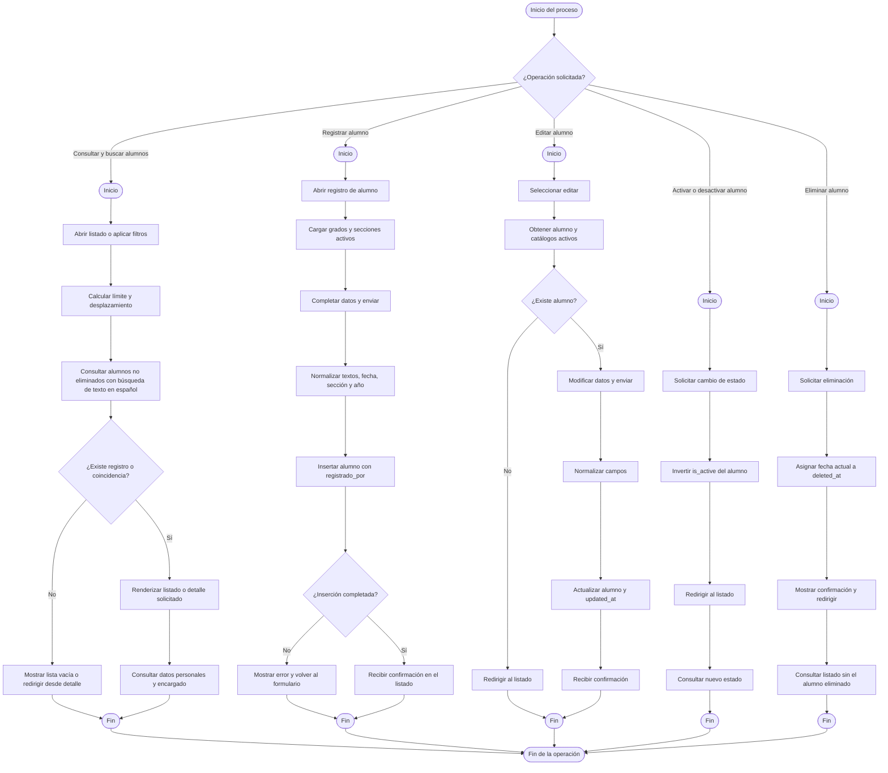

### A-04. Actividades por responsable

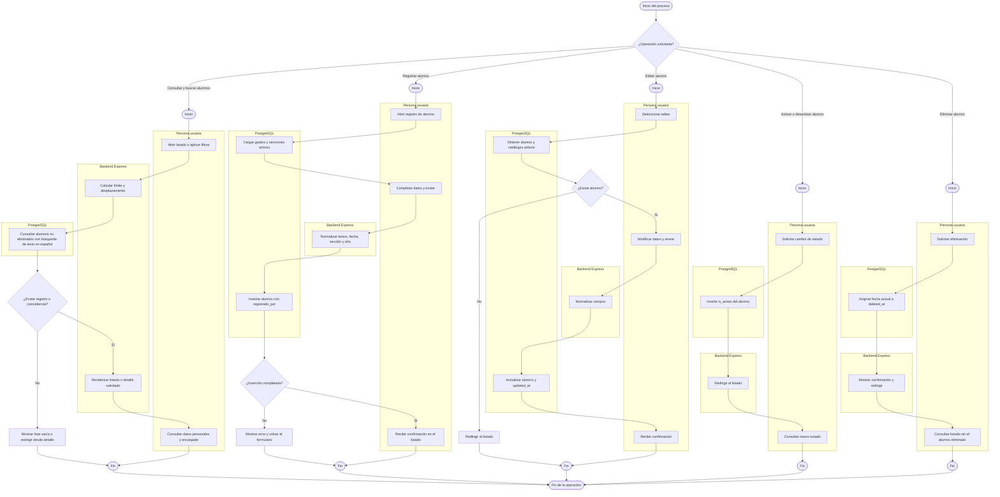

### S-04. Secuencia

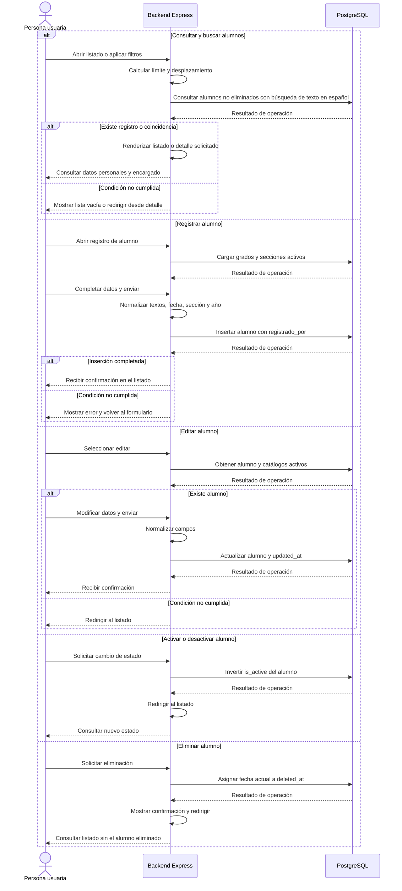

<a id="p-05"></a>

## P-05. Gestión de cuadros PRIM

**Requisito:** RF-05. Los criterios de aceptación CA-05.m y los pasos completos se encuentran en el DERCAS.

| Subactividad | Acceso | Resultado y limitaciones |
|---|---|---|
| 5.1. Consultar, buscar y abrir cuadros PRIM | documents.view | Listado, resultados y detalle; URL de cuadro con vigencia de 1800 segundos. Sin filtros, la vista de búsqueda no ejecuta consulta de cuadros. Id inexistente redirige. El host interno de MinIO puede impedir abrir el enlace desde el navegador. |
| 5.2. Registrar cuadro manual | documents.create | Cuadro manual con o sin adjunto. Fallo devuelve al formulario. Si MinIO guarda y PostgreSQL falla, no existe limpieza compensatoria. codigo no es único en la base. |
| 5.3. Validar cuadro PRIM | documents.validate | Cuadro marcado con responsable y fecha de validación. No se comprueba que el UPDATE afecte una fila ni se impide validar nuevamente. |
| 5.4. Eliminar cuadro y adjunto | documents.delete | Fila eliminada lógicamente y archivo eliminado físicamente. Si falla MinIO, no se alcanza el borrado lógico; si un job OCR comparte la clave, pierde también su documento original. |

### F-05. Flujo

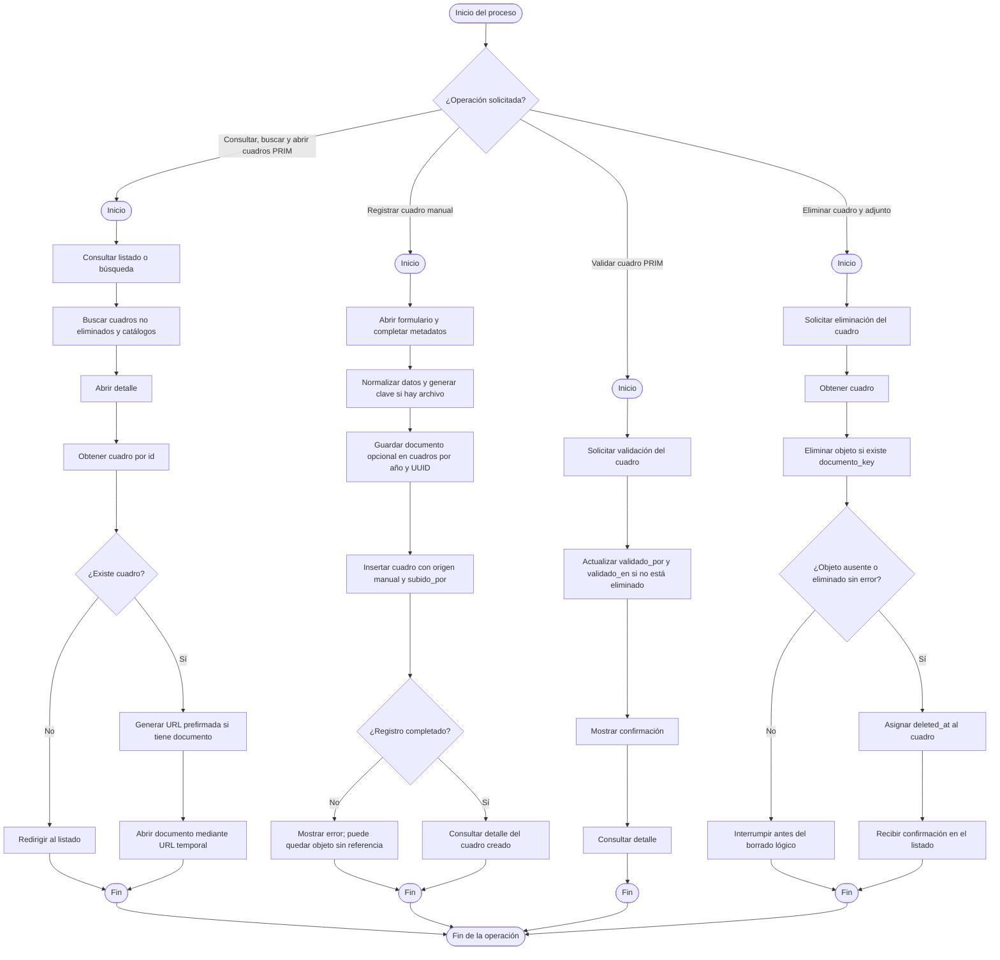

### A-05. Actividades por responsable

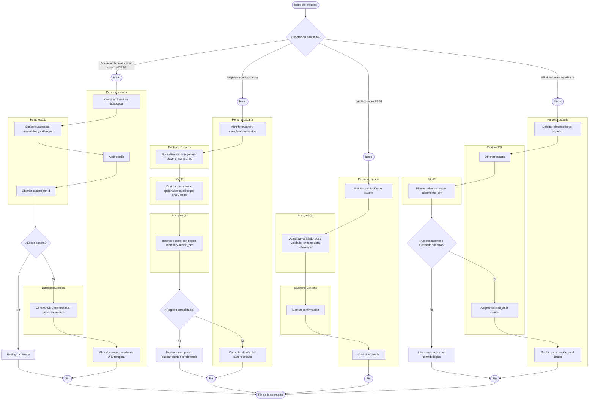

### S-05. Secuencia

```mermaid
sequenceDiagram
    actor U as Persona usuaria
    participant B as Backend Express
    participant D as PostgreSQL
    participant M as MinIO
    alt Consultar, buscar y abrir cuadros PRIM
        U->>B: Consultar listado o búsqueda
        B->>D: Buscar cuadros no eliminados y catálogos
        D-->>B: Resultado de operación
        U->>B: Abrir detalle
        B->>D: Obtener cuadro por id
        D-->>B: Resultado de operación
        alt Existe cuadro
        B->>B: Generar URL prefirmada si tiene documento
        B-->>U: Detalle con URL temporal si hay documento
        opt Cuadro con adjunto y endpoint accesible desde cliente
            U->>M: GET mediante URL prefirmada
            M-->>U: Documento
        end
        else Condición no cumplida
            B-->>U: Redirigir al listado
        end
    else Registrar cuadro manual
        U->>B: Abrir formulario y completar metadatos
        B->>B: Normalizar datos y generar clave si hay archivo
        B->>M: Guardar documento opcional en cuadros por año y UUID
        M-->>B: Resultado de operación
        B->>D: Insertar cuadro con origen manual y subido_por
        D-->>B: Resultado de operación
        alt Registro completado
        B-->>U: Consultar detalle del cuadro creado
        else Condición no cumplida
            B-->>U: Mostrar error; puede quedar objeto sin referencia
        end
    else Validar cuadro PRIM
        U->>B: Solicitar validación del cuadro
        B->>D: Actualizar validado_por y validado_en si no está eliminado
        D-->>B: Resultado de operación
        B->>B: Mostrar confirmación
        B-->>U: Consultar detalle
    else Eliminar cuadro y adjunto
        U->>B: Solicitar eliminación del cuadro
        B->>D: Obtener cuadro
        D-->>B: Resultado de operación
        B->>M: Eliminar objeto si existe documento_key
        M-->>B: Resultado de operación
        alt Objeto ausente o eliminado sin error
        B->>D: Asignar deleted_at al cuadro
        D-->>B: Resultado de operación
        B-->>U: Recibir confirmación en el listado
        else Condición no cumplida
            B-->>U: Interrumpir antes del borrado lógico
        end
    end
```

<a id="p-06"></a>

## P-06. Consulta y revisión de trabajos OCR

**Requisito:** RF-06. Los criterios de aceptación CA-06.m y los pasos completos se encuentran en el DERCAS.

| Subactividad | Acceso | Resultado y limitaciones |
|---|---|---|
| 6.1. Consultar trabajos OCR | Sesión autenticada | Trabajos visibles en páginas de 10 o 20. La ruta no exige ocr.view; el listado no filtra por propietario. |
| 6.2. Revisar extracción OCR | Rol director, administrativo o validador_ocr | Formulario de revisión con campos extraídos, confianza y documento si se obtiene URL. Si no existe el trabajo o no está en revision, redirigir al listado. Fallo al firmar URL permite renderizar sin documento. |

### F-06. Flujo

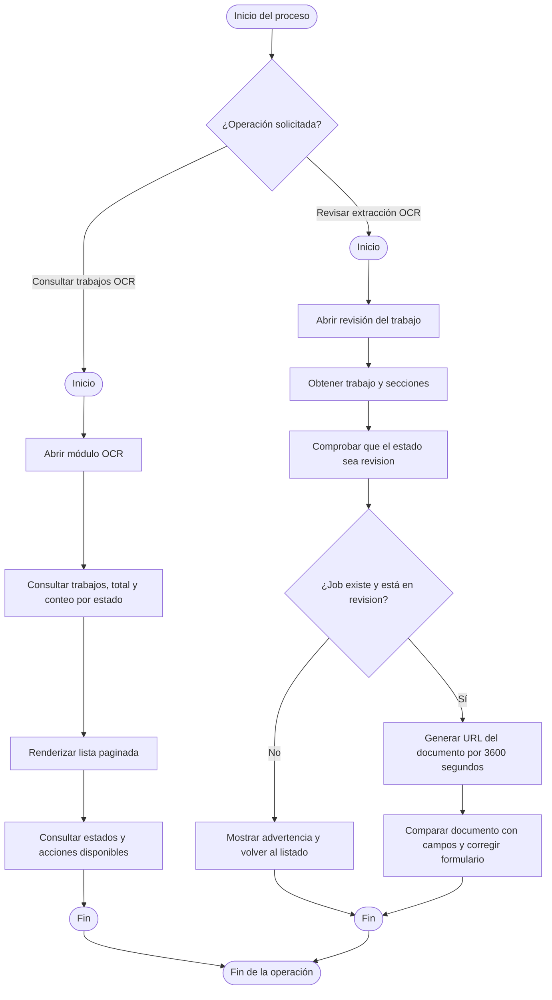

### A-06. Actividades por responsable

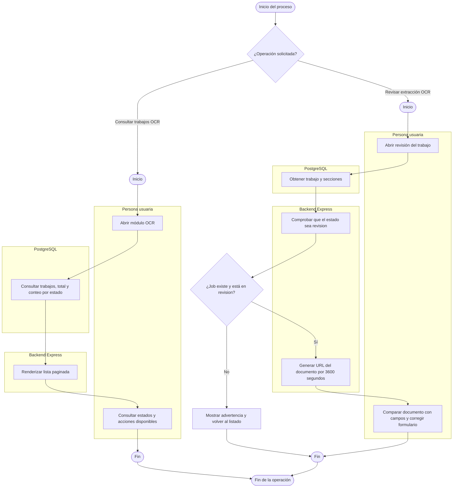

### S-06. Secuencia

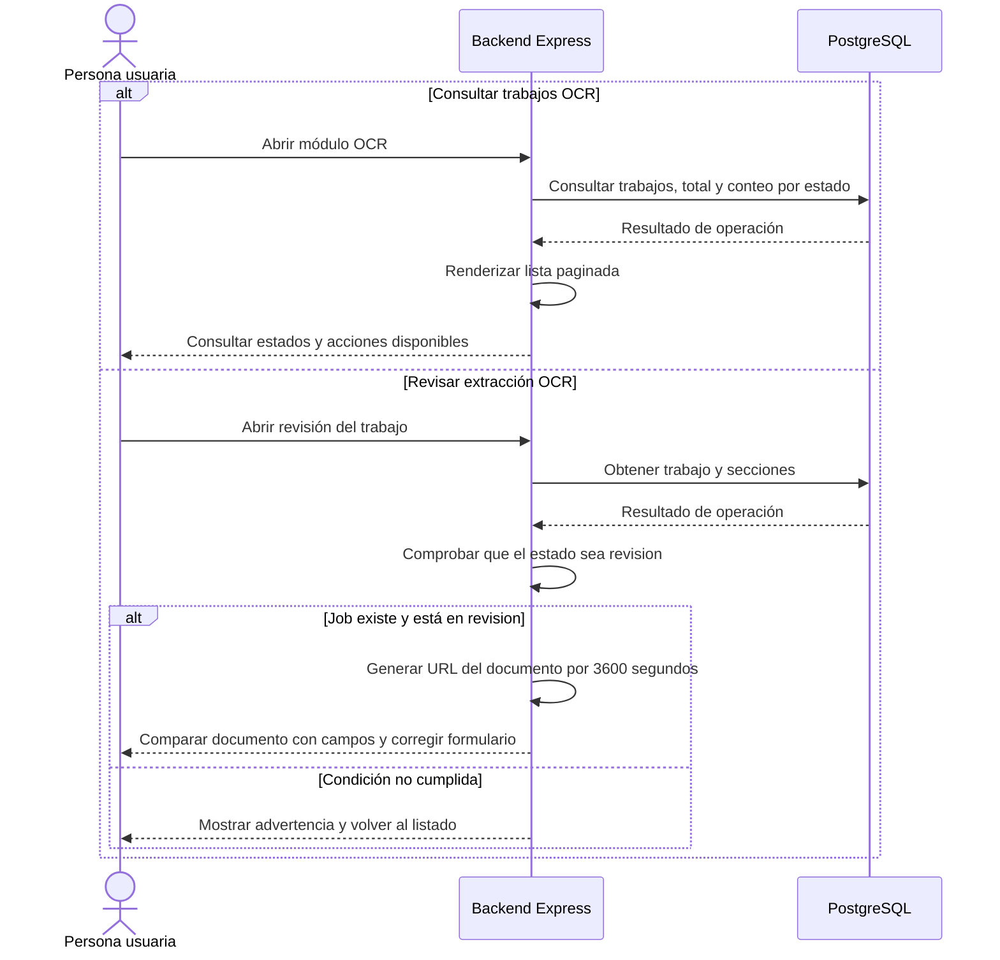

<a id="p-07"></a>

## P-07. Carga y procesamiento OCR

**Requisito:** RF-07. Los criterios de aceptación CA-07.m y los pasos completos se encuentran en el DERCAS.

| Subactividad | Acceso | Resultado y limitaciones |
|---|---|---|
| 7.1. Subir y procesar documento OCR | Rol director, administrativo o validador_ocr | Trabajo disponible para revisión humana. Archivo ausente devuelve al formulario. Error HTTP o de conexión intenta marcar rechazado. No existe cola persistente ni transición implementada a procesando. |

### F-07. Flujo

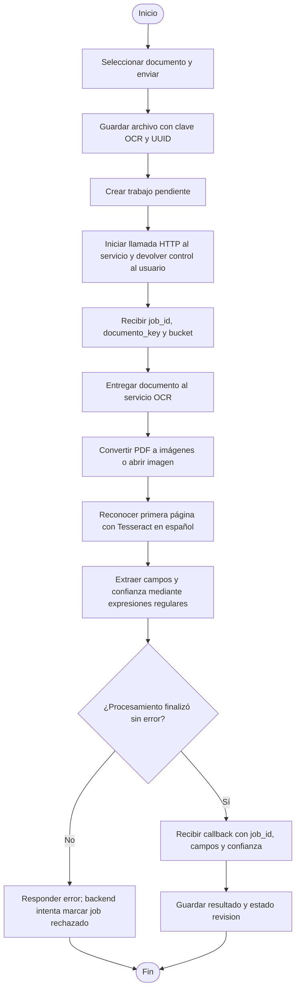

### A-07. Actividades por responsable

```mermaid
flowchart TD
    INI([Inicio])
    FIN([Fin])
    subgraph laneU["Persona usuaria"]
        N1["Seleccionar documento y enviar"]
    end
    subgraph laneB["Backend Express"]
        N4["Iniciar llamada HTTP al servicio y devolver control al usuario"]
        N10["Recibir callback con job_id, campos y confianza"]
    end
    subgraph laneD["PostgreSQL"]
        N3["Crear trabajo pendiente"]
        N11["Guardar resultado y estado revision"]
    end
    subgraph laneM["MinIO"]
        N2["Guardar archivo con clave OCR y UUID"]
        N6["Entregar documento al servicio OCR"]
    end
    subgraph laneO["Servicio OCR"]
        N5["Recibir job_id, documento_key y bucket"]
        N7["Convertir PDF a imágenes o abrir imagen"]
        N8["Reconocer primera página con Tesseract en español"]
        N9["Extraer campos y confianza mediante expresiones regulares"]
    end
    INI --> N1
    N1 --> N2
    N2 --> N3
    N3 --> N4
    N4 --> N5
    N5 --> N6
    N6 --> N7
    N7 --> N8
    N8 --> N9
    N9 --> G{"¿Procesamiento finalizó sin error?"}
    G -- Sí --> N10
    G -- No --> ERR["Responder error; backend intenta marcar job rechazado"]
    ERR --> FIN
    N10 --> N11
    N11 --> FIN
```

### S-07. Secuencia

```mermaid
sequenceDiagram
    actor U as Persona usuaria
    participant B as Backend Express
    participant D as PostgreSQL
    participant M as MinIO
    participant O as Servicio OCR
    U->>B: Seleccionar documento y enviar
    B->>M: Guardar archivo con clave OCR y UUID
    M-->>B: Resultado de operación
    B->>D: Crear trabajo pendiente
    D-->>B: Resultado de operación
    B-->>U: Trabajo recibido; volver al listado sin esperar OCR
    B->>O: POST /procesar con job_id, clave y bucket
    O->>M: Entregar documento al servicio OCR
    M-->>O: Resultado de operación
    O->>O: Convertir PDF a imágenes o abrir imagen
    O->>O: Reconocer primera página con Tesseract en español
    O->>O: Extraer campos y confianza mediante expresiones regulares
    alt Procesamiento finalizó sin error
    O->>B: POST /ocr/callback con campos y confianza
    B->>D: Guardar resultado y estado revision
    D-->>B: Resultado de operación
    B-->>O: JSON ok después de guardar resultado
    O-->>B: Respuesta a POST /procesar
    else Condición no cumplida
        O-->>B: Error de procesamiento
        B->>D: Intentar marcar trabajo rechazado con nota
    end
    Note over B,O: El HTTP interno permanece abierto durante el OCR; no hay cola durable
```

<a id="p-08"></a>

## P-08. Resolución y reprocesamiento OCR

**Requisito:** RF-08. Los criterios de aceptación CA-08.m y los pasos completos se encuentran en el DERCAS.

| Subactividad | Acceso | Resultado y limitaciones |
|---|---|---|
| 8.1. Aprobar OCR y crear cuadro | Rol director, administrativo o validador_ocr | Cuadro creado y job validado; la validación del job no llena validado_en del cuadro. No hay transacción conjunta ni comprobación del estado anterior; repetir POST puede crear cuadros adicionales. El MIME del cuadro se fija a application/pdf incluso para imágenes. |
| 8.2. Rechazar OCR | Rol director, administrativo o validador_ocr | Job rechazado sin crear cuadro. Las notas pueden estar vacías; el POST no verifica estado previo ni filas afectadas. |
| 8.3. Reprocesar OCR | Rol director, administrativo o validador_ocr | Intención: reutilizar documento y repetir P-07. Con el esquema actual, el reinicio falla. campos_extraidos y confianza son NOT NULL; resetToPendiente intenta escribir NULL. El controlador muestra error antes del nuevo envío. |

### F-08. Flujo

```mermaid
flowchart TD
    START([Inicio del proceso])
    CHOICE{"¿Operación solicitada?"}
    ENDING([Fin de la operación])
    START --> CHOICE
    OP17_INI([Inicio])
    OP17_FIN([Fin])
    OP17_N1["Enviar campos revisados y notas"]
    OP17_N2["Obtener trabajo por id"]
    OP17_N3["Crear cuadro de origen OCR con la misma clave de documento"]
    OP17_N4["Marcar trabajo validado y asociar cuadro y validador"]
    OP17_N5["Recibir confirmación y volver a OCR"]
    OP17_INI --> OP17_N1
    OP17_N1 --> OP17_N2
    OP17_N2 --> OP17_G{"¿Existe trabajo OCR?"}
    OP17_G -- Sí --> OP17_N3
    OP17_G -- No --> OP17_ERR["Mostrar error sin crear cuadro"]
    OP17_ERR --> OP17_FIN
    OP17_N3 --> OP17_N4
    OP17_N4 --> OP17_N5
    OP17_N5 --> OP17_FIN
    CHOICE -->|"Aprobar OCR y crear cuadro"| OP17_INI
    OP17_FIN --> ENDING
    OP18_INI([Inicio])
    OP18_FIN([Fin])
    OP18_N1["Escribir notas y rechazar"]
    OP18_N2["Actualizar estado rechazado, validador y notas"]
    OP18_N3["Mostrar mensaje y redirigir"]
    OP18_N4["Consultar trabajo rechazado"]
    OP18_INI --> OP18_N1
    OP18_N1 --> OP18_N2
    OP18_N2 --> OP18_N3
    OP18_N3 --> OP18_N4
    OP18_N4 --> OP18_FIN
    CHOICE -->|"Rechazar OCR"| OP18_INI
    OP18_FIN --> ENDING
    OP19_INI([Inicio])
    OP19_FIN([Fin])
    OP19_N1["Solicitar reprocesamiento"]
    OP19_N2["Obtener trabajo"]
    OP19_N3["Intentar fijar pendiente y limpiar campos con NULL"]
    OP19_N4["Si el reinicio tiene éxito, enviar nuevamente al servicio OCR"]
    OP19_N5["Recibir resultado de la solicitud"]
    OP19_INI --> OP19_N1
    OP19_N1 --> OP19_N2
    OP19_N2 --> OP19_N3
    OP19_N3 --> OP19_G{"¿Esquema permite reinicio con NULL?"}
    OP19_G -- Sí --> OP19_N4
    OP19_G -- No --> OP19_ERR["Con esquema actual: error SQL y mensaje al usuario"]
    OP19_ERR --> OP19_FIN
    OP19_N4 --> OP19_N5
    OP19_N5 --> OP19_FIN
    CHOICE -->|"Reprocesar OCR"| OP19_INI
    OP19_FIN --> ENDING
```

### A-08. Actividades por responsable

```mermaid
flowchart TD
    START([Inicio del proceso])
    CHOICE{"¿Operación solicitada?"}
    ENDING([Fin de la operación])
    START --> CHOICE
    OP17_INI([Inicio])
    OP17_FIN([Fin])
    subgraph OP17_laneU["Persona usuaria"]
        OP17_N1["Enviar campos revisados y notas"]
        OP17_N5["Recibir confirmación y volver a OCR"]
    end
    subgraph OP17_laneD["PostgreSQL"]
        OP17_N2["Obtener trabajo por id"]
        OP17_N3["Crear cuadro de origen OCR con la misma clave de documento"]
        OP17_N4["Marcar trabajo validado y asociar cuadro y validador"]
    end
    OP17_INI --> OP17_N1
    OP17_N1 --> OP17_N2
    OP17_N2 --> OP17_G{"¿Existe trabajo OCR?"}
    OP17_G -- Sí --> OP17_N3
    OP17_G -- No --> OP17_ERR["Mostrar error sin crear cuadro"]
    OP17_ERR --> OP17_FIN
    OP17_N3 --> OP17_N4
    OP17_N4 --> OP17_N5
    OP17_N5 --> OP17_FIN
    CHOICE -->|"Aprobar OCR y crear cuadro"| OP17_INI
    OP17_FIN --> ENDING
    OP18_INI([Inicio])
    OP18_FIN([Fin])
    subgraph OP18_laneU["Persona usuaria"]
        OP18_N1["Escribir notas y rechazar"]
        OP18_N4["Consultar trabajo rechazado"]
    end
    subgraph OP18_laneB["Backend Express"]
        OP18_N3["Mostrar mensaje y redirigir"]
    end
    subgraph OP18_laneD["PostgreSQL"]
        OP18_N2["Actualizar estado rechazado, validador y notas"]
    end
    OP18_INI --> OP18_N1
    OP18_N1 --> OP18_N2
    OP18_N2 --> OP18_N3
    OP18_N3 --> OP18_N4
    OP18_N4 --> OP18_FIN
    CHOICE -->|"Rechazar OCR"| OP18_INI
    OP18_FIN --> ENDING
    OP19_INI([Inicio])
    OP19_FIN([Fin])
    subgraph OP19_laneU["Persona usuaria"]
        OP19_N1["Solicitar reprocesamiento"]
        OP19_N5["Recibir resultado de la solicitud"]
    end
    subgraph OP19_laneB["Backend Express"]
        OP19_N4["Si el reinicio tiene éxito, enviar nuevamente al servicio OCR"]
    end
    subgraph OP19_laneD["PostgreSQL"]
        OP19_N2["Obtener trabajo"]
        OP19_N3["Intentar fijar pendiente y limpiar campos con NULL"]
    end
    OP19_INI --> OP19_N1
    OP19_N1 --> OP19_N2
    OP19_N2 --> OP19_N3
    OP19_N3 --> OP19_G{"¿Esquema permite reinicio con NULL?"}
    OP19_G -- Sí --> OP19_N4
    OP19_G -- No --> OP19_ERR["Con esquema actual: error SQL y mensaje al usuario"]
    OP19_ERR --> OP19_FIN
    OP19_N4 --> OP19_N5
    OP19_N5 --> OP19_FIN
    CHOICE -->|"Reprocesar OCR"| OP19_INI
    OP19_FIN --> ENDING
```

### S-08. Secuencia

```mermaid
sequenceDiagram
    actor U as Persona usuaria
    participant B as Backend Express
    participant D as PostgreSQL
    alt Aprobar OCR y crear cuadro
        U->>B: Enviar campos revisados y notas
        B->>D: Obtener trabajo por id
        D-->>B: Resultado de operación
        alt Existe trabajo OCR
        B->>D: Crear cuadro de origen OCR con la misma clave de documento
        D-->>B: Resultado de operación
        B->>D: Marcar trabajo validado y asociar cuadro y validador
        D-->>B: Resultado de operación
        B-->>U: Recibir confirmación y volver a OCR
        else Condición no cumplida
            B-->>U: Mostrar error sin crear cuadro
        end
    else Rechazar OCR
        U->>B: Escribir notas y rechazar
        B->>D: Actualizar estado rechazado, validador y notas
        D-->>B: Resultado de operación
        B->>B: Mostrar mensaje y redirigir
        B-->>U: Consultar trabajo rechazado
    else Reprocesar OCR
        U->>B: Solicitar reprocesamiento
        B->>D: Obtener trabajo
        D-->>B: Resultado de operación
        B->>D: Intentar fijar pendiente y limpiar campos con NULL
        D-->>B: Resultado de operación
        alt Esquema permite reinicio con NULL
        B->>B: Si el reinicio tiene éxito, enviar nuevamente al servicio OCR
        B-->>U: Recibir resultado de la solicitud
        else Condición no cumplida
            B-->>U: Con esquema actual: error SQL y mensaje al usuario
        end
        Note over B,D: La rama de éxito no se alcanza con las columnas NOT NULL del esquema inicial
    end
```

<a id="p-09"></a>

## P-09. Administración de usuarios

**Requisito:** RF-09. Los criterios de aceptación CA-09.m y los pasos completos se encuentran en el DERCAS.

| Subactividad | Acceso | Resultado y limitaciones |
|---|---|---|
| 9.1. Administrar usuarios | admin.users | Cuenta creada, editada o activada/desactivada; username no se edita mediante el controlador. Username duplicado produce error. Cambio de rol o desactivación no invalida sesiones ya existentes automáticamente. |

### F-09. Flujo

```mermaid
flowchart TD
    INI([Inicio])
    FIN([Fin])
    N1["Abrir usuarios y elegir crear, editar o cambiar estado"]
    N2["Cargar usuarios y roles"]
    N3["Para creación o nueva contraseña generar hash bcrypt"]
    N4["Insertar usuario, actualizar nombre y rol, o invertir activo según acción"]
    N5["Consultar listado y resultado"]
    INI --> N1
    N1 --> N2
    N2 --> N3
    N3 --> N4
    N4 --> G{"¿Operación completada?"}
    G -- Sí --> N5
    G -- No --> ERR["Creación o edición fallida: mostrar error"]
    ERR --> FIN
    N5 --> FIN
```

### A-09. Actividades por responsable

```mermaid
flowchart TD
    INI([Inicio])
    FIN([Fin])
    subgraph laneU["Persona usuaria"]
        N1["Abrir usuarios y elegir crear, editar o cambiar estado"]
        N5["Consultar listado y resultado"]
    end
    subgraph laneB["Backend Express"]
        N3["Para creación o nueva contraseña generar hash bcrypt"]
    end
    subgraph laneD["PostgreSQL"]
        N2["Cargar usuarios y roles"]
        N4["Insertar usuario, actualizar nombre y rol, o invertir activo según acción"]
    end
    INI --> N1
    N1 --> N2
    N2 --> N3
    N3 --> N4
    N4 --> G{"¿Operación completada?"}
    G -- Sí --> N5
    G -- No --> ERR["Creación o edición fallida: mostrar error"]
    ERR --> FIN
    N5 --> FIN
```

### S-09. Secuencia

```mermaid
sequenceDiagram
    actor U as Persona usuaria
    participant B as Backend Express
    participant D as PostgreSQL
    U->>B: Abrir usuarios y elegir crear, editar o cambiar estado
    B->>D: Cargar usuarios y roles
    D-->>B: Resultado de operación
    B->>B: Para creación o nueva contraseña generar hash bcrypt
    B->>D: Insertar usuario, actualizar nombre y rol, o invertir activo según acción
    D-->>B: Resultado de operación
    alt Operación completada
    B-->>U: Consultar listado y resultado
    else Condición no cumplida
        B-->>U: Creación o edición fallida: mostrar error
    end
```

<a id="p-10"></a>

## P-10. Administración de roles y permisos

**Requisito:** RF-10. Los criterios de aceptación CA-10.m y los pasos completos se encuentran en el DERCAS.

| Subactividad | Acceso | Resultado y limitaciones |
|---|---|---|
| 10.1. Administrar roles y permisos | admin.roles | Rol disponible y asociaciones actualizadas. Reemplazo hace DELETE y luego INSERT sin transacción. Los scopes se almacenan pero no limitan consultas; permisos de sesiones vigentes no se recargan. |

### F-10. Flujo

```mermaid
flowchart TD
    INI([Inicio])
    FIN([Fin])
    N1["Consultar roles y crear rol o abrir edición de permisos"]
    N2["Consultar catálogo y permisos del rol"]
    N3["Definir permisos y alcances"]
    N4["Convertir selección a identificadores y scopes"]
    N5["Crear rol o reemplazar sus asociaciones de permisos"]
    N6["Consultar confirmación"]
    INI --> N1
    N1 --> N2
    N2 --> G{"¿Rol disponible para editar o crear?"}
    G -- Sí --> N3
    G -- No --> ERR["Id inexistente en edición: volver a roles"]
    ERR --> FIN
    N3 --> N4
    N4 --> N5
    N5 --> N6
    N6 --> FIN
```

### A-10. Actividades por responsable

```mermaid
flowchart TD
    INI([Inicio])
    FIN([Fin])
    subgraph laneU["Persona usuaria"]
        N1["Consultar roles y crear rol o abrir edición de permisos"]
        N3["Definir permisos y alcances"]
        N6["Consultar confirmación"]
    end
    subgraph laneB["Backend Express"]
        N4["Convertir selección a identificadores y scopes"]
    end
    subgraph laneD["PostgreSQL"]
        N2["Consultar catálogo y permisos del rol"]
        N5["Crear rol o reemplazar sus asociaciones de permisos"]
    end
    INI --> N1
    N1 --> N2
    N2 --> G{"¿Rol disponible para editar o crear?"}
    G -- Sí --> N3
    G -- No --> ERR["Id inexistente en edición: volver a roles"]
    ERR --> FIN
    N3 --> N4
    N4 --> N5
    N5 --> N6
    N6 --> FIN
```

### S-10. Secuencia

```mermaid
sequenceDiagram
    actor U as Persona usuaria
    participant B as Backend Express
    participant D as PostgreSQL
    U->>B: Consultar roles y crear rol o abrir edición de permisos
    B->>D: Consultar catálogo y permisos del rol
    D-->>B: Resultado de operación
    alt Rol disponible para editar o crear
    U->>B: Definir permisos y alcances
    B->>B: Convertir selección a identificadores y scopes
    B->>D: Crear rol o reemplazar sus asociaciones de permisos
    D-->>B: Resultado de operación
    B-->>U: Consultar confirmación
    else Condición no cumplida
        B-->>U: Id inexistente en edición: volver a roles
    end
```

<a id="p-11"></a>

## P-11. Administración de grados y secciones

**Requisito:** RF-11. Los criterios de aceptación CA-11.m y los pasos completos se encuentran en el DERCAS.

| Subactividad | Acceso | Resultado y limitaciones |
|---|---|---|
| 11.1. Administrar grados | admin.grades | Catálogo de grados actualizado; sort_order participa en promoción. Nombre repetido viola UNIQUE. Desactivar un grado no elimina sus secciones ni alumnos. |
| 11.2. Administrar secciones | admin.grades | Sección vinculada a grado; la edición no cambia grade_id. No puede repetirse el nombre de sección dentro del mismo grado. La desactivación no desvincula alumnos. |

### F-11. Flujo

```mermaid
flowchart TD
    START([Inicio del proceso])
    CHOICE{"¿Operación solicitada?"}
    ENDING([Fin de la operación])
    START --> CHOICE
    OP22_INI([Inicio])
    OP22_FIN([Fin])
    OP22_N1["Abrir grados y elegir operación"]
    OP22_N2["Consultar grados y secciones"]
    OP22_N3["Enviar datos o cambio de estado"]
    OP22_N4["Normalizar nombre y orden"]
    OP22_N5["Crear, actualizar o invertir is_active del grado"]
    OP22_N6["Consultar resultado"]
    OP22_INI --> OP22_N1
    OP22_N1 --> OP22_N2
    OP22_N2 --> OP22_N3
    OP22_N3 --> OP22_N4
    OP22_N4 --> OP22_N5
    OP22_N5 --> OP22_G{"¿Escritura completada?"}
    OP22_G -- Sí --> OP22_N6
    OP22_G -- No --> OP22_ERR["Alta o edición fallida: informar error"]
    OP22_ERR --> OP22_FIN
    OP22_N6 --> OP22_FIN
    CHOICE -->|"Administrar grados"| OP22_INI
    OP22_FIN --> ENDING
    OP23_INI([Inicio])
    OP23_FIN([Fin])
    OP23_N1["Elegir crear, editar o cambiar estado de sección"]
    OP23_N2["Consultar grado asociado cuando se crea"]
    OP23_N3["Preparar nombre y etiqueta visible"]
    OP23_N4["Insertar sección, editar nombres o invertir is_active"]
    OP23_N5["Consultar secciones del catálogo"]
    OP23_INI --> OP23_N1
    OP23_N1 --> OP23_N2
    OP23_N2 --> OP23_N3
    OP23_N3 --> OP23_N4
    OP23_N4 --> OP23_G{"¿Escritura completada?"}
    OP23_G -- Sí --> OP23_N5
    OP23_G -- No --> OP23_ERR["Alta o edición fallida: informar error"]
    OP23_ERR --> OP23_FIN
    OP23_N5 --> OP23_FIN
    CHOICE -->|"Administrar secciones"| OP23_INI
    OP23_FIN --> ENDING
```

### A-11. Actividades por responsable

```mermaid
flowchart TD
    START([Inicio del proceso])
    CHOICE{"¿Operación solicitada?"}
    ENDING([Fin de la operación])
    START --> CHOICE
    OP22_INI([Inicio])
    OP22_FIN([Fin])
    subgraph OP22_laneU["Persona usuaria"]
        OP22_N1["Abrir grados y elegir operación"]
        OP22_N3["Enviar datos o cambio de estado"]
        OP22_N6["Consultar resultado"]
    end
    subgraph OP22_laneB["Backend Express"]
        OP22_N4["Normalizar nombre y orden"]
    end
    subgraph OP22_laneD["PostgreSQL"]
        OP22_N2["Consultar grados y secciones"]
        OP22_N5["Crear, actualizar o invertir is_active del grado"]
    end
    OP22_INI --> OP22_N1
    OP22_N1 --> OP22_N2
    OP22_N2 --> OP22_N3
    OP22_N3 --> OP22_N4
    OP22_N4 --> OP22_N5
    OP22_N5 --> OP22_G{"¿Escritura completada?"}
    OP22_G -- Sí --> OP22_N6
    OP22_G -- No --> OP22_ERR["Alta o edición fallida: informar error"]
    OP22_ERR --> OP22_FIN
    OP22_N6 --> OP22_FIN
    CHOICE -->|"Administrar grados"| OP22_INI
    OP22_FIN --> ENDING
    OP23_INI([Inicio])
    OP23_FIN([Fin])
    subgraph OP23_laneU["Persona usuaria"]
        OP23_N1["Elegir crear, editar o cambiar estado de sección"]
        OP23_N5["Consultar secciones del catálogo"]
    end
    subgraph OP23_laneB["Backend Express"]
        OP23_N3["Preparar nombre y etiqueta visible"]
    end
    subgraph OP23_laneD["PostgreSQL"]
        OP23_N2["Consultar grado asociado cuando se crea"]
        OP23_N4["Insertar sección, editar nombres o invertir is_active"]
    end
    OP23_INI --> OP23_N1
    OP23_N1 --> OP23_N2
    OP23_N2 --> OP23_N3
    OP23_N3 --> OP23_N4
    OP23_N4 --> OP23_G{"¿Escritura completada?"}
    OP23_G -- Sí --> OP23_N5
    OP23_G -- No --> OP23_ERR["Alta o edición fallida: informar error"]
    OP23_ERR --> OP23_FIN
    OP23_N5 --> OP23_FIN
    CHOICE -->|"Administrar secciones"| OP23_INI
    OP23_FIN --> ENDING
```

### S-11. Secuencia

```mermaid
sequenceDiagram
    actor U as Persona usuaria
    participant B as Backend Express
    participant D as PostgreSQL
    alt Administrar grados
        U->>B: Abrir grados y elegir operación
        B->>D: Consultar grados y secciones
        D-->>B: Resultado de operación
        U->>B: Enviar datos o cambio de estado
        B->>B: Normalizar nombre y orden
        B->>D: Crear, actualizar o invertir is_active del grado
        D-->>B: Resultado de operación
        alt Escritura completada
        B-->>U: Consultar resultado
        else Condición no cumplida
            B-->>U: Alta o edición fallida: informar error
        end
    else Administrar secciones
        U->>B: Elegir crear, editar o cambiar estado de sección
        B->>D: Consultar grado asociado cuando se crea
        D-->>B: Resultado de operación
        B->>B: Preparar nombre y etiqueta visible
        B->>D: Insertar sección, editar nombres o invertir is_active
        D-->>B: Resultado de operación
        alt Escritura completada
        B-->>U: Consultar secciones del catálogo
        else Condición no cumplida
            B-->>U: Alta o edición fallida: informar error
        end
    end
```

<a id="p-12"></a>

## P-12. Administración de cursos

**Requisito:** RF-12. Los criterios de aceptación CA-12.m y los pasos completos se encuentran en el DERCAS.

| Subactividad | Acceso | Resultado y limitaciones |
|---|---|---|
| 12.1. Administrar cursos | admin.courses | Cursos disponibles para asignaciones cuando están activos. Nombre de curso único; no existe gestión de notas ni calificaciones asociada a este catálogo. |

### F-12. Flujo

```mermaid
flowchart TD
    INI([Inicio])
    FIN([Fin])
    N1["Consultar o buscar cursos y elegir operación"]
    N2["Obtener catálogo de cursos"]
    N3["Filtrar nombre o abreviatura y paginar en memoria"]
    N4["Enviar creación, edición o cambio de estado"]
    N5["Insertar, actualizar o invertir is_active"]
    N6["Consultar resultado"]
    INI --> N1
    N1 --> N2
    N2 --> N3
    N3 --> N4
    N4 --> N5
    N5 --> G{"¿Escritura completada?"}
    G -- Sí --> N6
    G -- No --> ERR["Alta o edición fallida: informar error"]
    ERR --> FIN
    N6 --> FIN
```

### A-12. Actividades por responsable

```mermaid
flowchart TD
    INI([Inicio])
    FIN([Fin])
    subgraph laneU["Persona usuaria"]
        N1["Consultar o buscar cursos y elegir operación"]
        N4["Enviar creación, edición o cambio de estado"]
        N6["Consultar resultado"]
    end
    subgraph laneB["Backend Express"]
        N3["Filtrar nombre o abreviatura y paginar en memoria"]
    end
    subgraph laneD["PostgreSQL"]
        N2["Obtener catálogo de cursos"]
        N5["Insertar, actualizar o invertir is_active"]
    end
    INI --> N1
    N1 --> N2
    N2 --> N3
    N3 --> N4
    N4 --> N5
    N5 --> G{"¿Escritura completada?"}
    G -- Sí --> N6
    G -- No --> ERR["Alta o edición fallida: informar error"]
    ERR --> FIN
    N6 --> FIN
```

### S-12. Secuencia

```mermaid
sequenceDiagram
    actor U as Persona usuaria
    participant B as Backend Express
    participant D as PostgreSQL
    U->>B: Consultar o buscar cursos y elegir operación
    B->>D: Obtener catálogo de cursos
    D-->>B: Resultado de operación
    B->>B: Filtrar nombre o abreviatura y paginar en memoria
    U->>B: Enviar creación, edición o cambio de estado
    B->>D: Insertar, actualizar o invertir is_active
    D-->>B: Resultado de operación
    alt Escritura completada
    B-->>U: Consultar resultado
    else Condición no cumplida
        B-->>U: Alta o edición fallida: informar error
    end
```

<a id="p-13"></a>

## P-13. Administración de maestros

**Requisito:** RF-13. Los criterios de aceptación CA-13.m y los pasos completos se encuentran en el DERCAS.

| Subactividad | Acceso | Resultado y limitaciones |
|---|---|---|
| 13.1. Administrar maestros | admin.teachers | Ficha docente actualizada, separada de la cuenta de acceso. La edición no modifica user_id; desactivar maestro no desactiva automáticamente su usuario o asignaciones. |

### F-13. Flujo

```mermaid
flowchart TD
    INI([Inicio])
    FIN([Fin])
    N1["Consultar maestros y elegir operación"]
    N2["Cargar maestros, asignaciones y catálogos activos"]
    N3["Filtrar por nombre, correo o teléfono y paginar"]
    N4["Enviar datos o cambio de estado"]
    N5["Crear, editar contacto o invertir is_active del maestro"]
    N6["Consultar resultado"]
    INI --> N1
    N1 --> N2
    N2 --> N3
    N3 --> N4
    N4 --> N5
    N5 --> G{"¿Escritura completada?"}
    G -- Sí --> N6
    G -- No --> ERR["Alta o edición fallida: informar error"]
    ERR --> FIN
    N6 --> FIN
```

### A-13. Actividades por responsable

```mermaid
flowchart TD
    INI([Inicio])
    FIN([Fin])
    subgraph laneU["Persona usuaria"]
        N1["Consultar maestros y elegir operación"]
        N4["Enviar datos o cambio de estado"]
        N6["Consultar resultado"]
    end
    subgraph laneB["Backend Express"]
        N3["Filtrar por nombre, correo o teléfono y paginar"]
    end
    subgraph laneD["PostgreSQL"]
        N2["Cargar maestros, asignaciones y catálogos activos"]
        N5["Crear, editar contacto o invertir is_active del maestro"]
    end
    INI --> N1
    N1 --> N2
    N2 --> N3
    N3 --> N4
    N4 --> N5
    N5 --> G{"¿Escritura completada?"}
    G -- Sí --> N6
    G -- No --> ERR["Alta o edición fallida: informar error"]
    ERR --> FIN
    N6 --> FIN
```

### S-13. Secuencia

```mermaid
sequenceDiagram
    actor U as Persona usuaria
    participant B as Backend Express
    participant D as PostgreSQL
    U->>B: Consultar maestros y elegir operación
    B->>D: Cargar maestros, asignaciones y catálogos activos
    D-->>B: Resultado de operación
    B->>B: Filtrar por nombre, correo o teléfono y paginar
    U->>B: Enviar datos o cambio de estado
    B->>D: Crear, editar contacto o invertir is_active del maestro
    D-->>B: Resultado de operación
    alt Escritura completada
    B-->>U: Consultar resultado
    else Condición no cumplida
        B-->>U: Alta o edición fallida: informar error
    end
```

<a id="p-14"></a>

## P-14. Asignación docente

**Requisito:** RF-14. Los criterios de aceptación CA-14.m y los pasos completos se encuentran en el DERCAS.

| Subactividad | Acceso | Resultado y limitaciones |
|---|---|---|
| 14.1. Asignar maestro a curso y sección | admin.teachers | Asignación por docente, curso, sección y año; duplicados se omiten. La confirmación no distingue duplicado. Las FK no garantizan que grade_id corresponda al grado de section_id. No hay ruta para editar o desactivar asignaciones. |

### F-14. Flujo

```mermaid
flowchart TD
    INI([Inicio])
    FIN([Fin])
    N1["Seleccionar maestro, curso, grado, sección y año"]
    N2["Convertir identificadores y año a números"]
    N3["Insertar asignación con ON CONFLICT DO NOTHING"]
    N4["Mostrar confirmación y redirigir"]
    N5["Consultar asignaciones"]
    INI --> N1
    N1 --> N2
    N2 --> N3
    N3 --> G{"¿Consulta SQL completada?"}
    G -- Sí --> N4
    G -- No --> ERR["Mostrar error de asignación"]
    ERR --> FIN
    N4 --> N5
    N5 --> FIN
```

### A-14. Actividades por responsable

```mermaid
flowchart TD
    INI([Inicio])
    FIN([Fin])
    subgraph laneU["Persona usuaria"]
        N1["Seleccionar maestro, curso, grado, sección y año"]
        N5["Consultar asignaciones"]
    end
    subgraph laneB["Backend Express"]
        N2["Convertir identificadores y año a números"]
        N4["Mostrar confirmación y redirigir"]
    end
    subgraph laneD["PostgreSQL"]
        N3["Insertar asignación con ON CONFLICT DO NOTHING"]
    end
    INI --> N1
    N1 --> N2
    N2 --> N3
    N3 --> G{"¿Consulta SQL completada?"}
    G -- Sí --> N4
    G -- No --> ERR["Mostrar error de asignación"]
    ERR --> FIN
    N4 --> N5
    N5 --> FIN
```

### S-14. Secuencia

```mermaid
sequenceDiagram
    actor U as Persona usuaria
    participant B as Backend Express
    participant D as PostgreSQL
    U->>B: Seleccionar maestro, curso, grado, sección y año
    B->>B: Convertir identificadores y año a números
    B->>D: Insertar asignación con ON CONFLICT DO NOTHING
    D-->>B: Resultado de operación
    alt Consulta SQL completada
    B->>B: Mostrar confirmación y redirigir
    B-->>U: Consultar asignaciones
    else Condición no cumplida
        B-->>U: Mostrar error de asignación
    end
```

<a id="p-15"></a>

## P-15. Importación masiva de datos

**Requisito:** RF-15. Los criterios de aceptación CA-15.m y los pasos completos se encuentran en el DERCAS.

| Subactividad | Acceso | Resultado y limitaciones |
|---|---|---|
| 15.1. Descargar plantilla de importación | admin.users | Archivo plantilla_modulo.xlsx. Módulo no admitido redirige a /admin, que no tiene una página raíz implementada. |
| 15.2. Importar registros desde Excel | admin.users para todos los módulos | Importación parcial: filas válidas persistidas; mensaje muestra hasta tres errores. No es una operación atómica. En alumnos una sección no encontrada registra error pero puede insertar sin sección. Asignaciones duplicadas pueden contabilizarse como insertadas aunque ON CONFLICT no inserte. |

### F-15. Flujo

```mermaid
flowchart TD
    START([Inicio del proceso])
    CHOICE{"¿Operación solicitada?"}
    ENDING([Fin de la operación])
    START --> CHOICE
    OP27_INI([Inicio])
    OP27_FIN([Fin])
    OP27_N1["Solicitar plantilla del módulo"]
    OP27_N2["Verificar módulo permitido"]
    OP27_N3["Crear libro XLSX con encabezados, ejemplo e instrucciones"]
    OP27_N4["Descargar plantilla y reemplazar fila de ejemplo"]
    OP27_INI --> OP27_N1
    OP27_N1 --> OP27_N2
    OP27_N2 --> OP27_G{"¿Módulo permitido?"}
    OP27_G -- Sí --> OP27_N3
    OP27_G -- No --> OP27_ERR["Redirigir a /admin sin página raíz definida"]
    OP27_ERR --> OP27_FIN
    OP27_N3 --> OP27_N4
    OP27_N4 --> OP27_FIN
    CHOICE -->|"Descargar plantilla de importación"| OP27_INI
    OP27_FIN --> ENDING
    OP28_INI([Inicio])
    OP28_FIN([Fin])
    OP28_N1["Completar plantilla y subir archivo"]
    OP28_N2["Verificar módulo y presencia del archivo"]
    OP28_N3["Leer primera hoja y cargar referencias necesarias"]
    OP28_N4["Recorrer filas y validar campos del módulo"]
    OP28_N5["Insertar fila válida o informar restricción SQL"]
    OP28_N6["Acumular insertados, omitidos y errores por fila"]
    OP28_N7["Consultar resumen y corregir filas fallidas"]
    OP28_INI --> OP28_N1
    OP28_N1 --> OP28_N2
    OP28_N2 --> OP28_G{"¿Módulo y archivo presentes?"}
    OP28_G -- Sí --> OP28_N3
    OP28_G -- No --> OP28_ERR["Rechazar solicitud o volver al módulo con mensaje"]
    OP28_ERR --> OP28_FIN
    OP28_N3 --> OP28_N4
    OP28_N4 --> OP28_N5
    OP28_N5 --> OP28_N6
    OP28_N6 --> OP28_N7
    OP28_N7 --> OP28_FIN
    CHOICE -->|"Importar registros desde Excel"| OP28_INI
    OP28_FIN --> ENDING
```

### A-15. Actividades por responsable

```mermaid
flowchart TD
    START([Inicio del proceso])
    CHOICE{"¿Operación solicitada?"}
    ENDING([Fin de la operación])
    START --> CHOICE
    OP27_INI([Inicio])
    OP27_FIN([Fin])
    subgraph OP27_laneU["Persona usuaria"]
        OP27_N1["Solicitar plantilla del módulo"]
        OP27_N4["Descargar plantilla y reemplazar fila de ejemplo"]
    end
    subgraph OP27_laneB["Backend Express"]
        OP27_N2["Verificar módulo permitido"]
        OP27_N3["Crear libro XLSX con encabezados, ejemplo e instrucciones"]
    end
    OP27_INI --> OP27_N1
    OP27_N1 --> OP27_N2
    OP27_N2 --> OP27_G{"¿Módulo permitido?"}
    OP27_G -- Sí --> OP27_N3
    OP27_G -- No --> OP27_ERR["Redirigir a /admin sin página raíz definida"]
    OP27_ERR --> OP27_FIN
    OP27_N3 --> OP27_N4
    OP27_N4 --> OP27_FIN
    CHOICE -->|"Descargar plantilla de importación"| OP27_INI
    OP27_FIN --> ENDING
    OP28_INI([Inicio])
    OP28_FIN([Fin])
    subgraph OP28_laneU["Persona usuaria"]
        OP28_N1["Completar plantilla y subir archivo"]
        OP28_N7["Consultar resumen y corregir filas fallidas"]
    end
    subgraph OP28_laneB["Backend Express"]
        OP28_N2["Verificar módulo y presencia del archivo"]
        OP28_N3["Leer primera hoja y cargar referencias necesarias"]
        OP28_N4["Recorrer filas y validar campos del módulo"]
        OP28_N6["Acumular insertados, omitidos y errores por fila"]
    end
    subgraph OP28_laneD["PostgreSQL"]
        OP28_N5["Insertar fila válida o informar restricción SQL"]
    end
    OP28_INI --> OP28_N1
    OP28_N1 --> OP28_N2
    OP28_N2 --> OP28_G{"¿Módulo y archivo presentes?"}
    OP28_G -- Sí --> OP28_N3
    OP28_G -- No --> OP28_ERR["Rechazar solicitud o volver al módulo con mensaje"]
    OP28_ERR --> OP28_FIN
    OP28_N3 --> OP28_N4
    OP28_N4 --> OP28_N5
    OP28_N5 --> OP28_N6
    OP28_N6 --> OP28_N7
    OP28_N7 --> OP28_FIN
    CHOICE -->|"Importar registros desde Excel"| OP28_INI
    OP28_FIN --> ENDING
```

### S-15. Secuencia

```mermaid
sequenceDiagram
    actor U as Persona usuaria
    participant B as Backend Express
    participant D as PostgreSQL
    alt Descargar plantilla de importación
        U->>B: Solicitar plantilla del módulo
        B->>B: Verificar módulo permitido
        alt Módulo permitido
        B->>B: Crear libro XLSX con encabezados, ejemplo e instrucciones
        B-->>U: Descargar plantilla y reemplazar fila de ejemplo
        else Condición no cumplida
            B-->>U: Redirigir a /admin sin página raíz definida
        end
    else Importar registros desde Excel
        U->>B: Completar plantilla y subir archivo
        B->>B: Verificar módulo y presencia del archivo
        alt Módulo y archivo presentes
        B->>B: Leer primera hoja y cargar referencias necesarias
        B->>B: Recorrer filas y validar campos del módulo
        B->>D: Insertar fila válida o informar restricción SQL
        D-->>B: Resultado de operación
        B->>B: Acumular insertados, omitidos y errores por fila
        B-->>U: Consultar resumen y corregir filas fallidas
        else Condición no cumplida
            B-->>U: Rechazar solicitud o volver al módulo con mensaje
        end
    end
```

<a id="p-16"></a>

## P-16. Promoción de ciclo escolar

**Requisito:** RF-16. Los criterios de aceptación CA-16.m y los pasos completos se encuentran en el DERCAS.

| Subactividad | Acceso | Resultado y limitaciones |
|---|---|---|
| 16.1. Previsualizar promoción de ciclo | admin.users | Resumen de destinos previstos y alumnos sin sección. No comprueba existencia de sección destino en la vista previa; puede diferir de ejecución. No filtra alumnos inactivos. |
| 16.2. Ejecutar promoción de ciclo | admin.users | Sección actual sustituida; destino NULL se contabiliza como egreso. No hay transacción global, historial por ciclo ni protección contra repetición. Una sección destino ausente también produce NULL. Alumnos de grados inactivos pueden omitirse. |

### F-16. Flujo

```mermaid
flowchart TD
    START([Inicio del proceso])
    CHOICE{"¿Operación solicitada?"}
    ENDING([Fin de la operación])
    START --> CHOICE
    OP29_INI([Inicio])
    OP29_FIN([Fin])
    OP29_N1["Abrir ciclo escolar"]
    OP29_N2["Consultar grados activos, secciones y alumnos no eliminados"]
    OP29_N3["Calcular siguiente grado según sort_order más uno"]
    OP29_N4["Agrupar cantidades y contar alumnos sin sección"]
    OP29_N5["Revisar vista previa por grado y sección"]
    OP29_INI --> OP29_N1
    OP29_N1 --> OP29_N2
    OP29_N2 --> OP29_N3
    OP29_N3 --> OP29_N4
    OP29_N4 --> OP29_N5
    OP29_N5 --> OP29_FIN
    CHOICE -->|"Previsualizar promoción de ciclo"| OP29_INI
    OP29_FIN --> ENDING
    OP30_INI([Inicio])
    OP30_FIN([Fin])
    OP30_N1["Solicitar promoción tras revisar vista previa"]
    OP30_N2["Obtener grados activos, secciones y alumnos con sección"]
    OP30_N3["Construir mapa al grado con sort_order más uno y misma sección"]
    OP30_N4["Para cada alumno resolver sección destino o NULL"]
    OP30_N5["Actualizar section_id de cada alumno"]
    OP30_N6["Contar todos los alumnos que quedan sin sección"]
    OP30_N7["Consultar promovidos, egresados y sin sección"]
    OP30_INI --> OP30_N1
    OP30_N1 --> OP30_N2
    OP30_N2 --> OP30_N3
    OP30_N3 --> OP30_N4
    OP30_N4 --> OP30_N5
    OP30_N5 --> OP30_N6
    OP30_N6 --> OP30_N7
    OP30_N7 --> OP30_FIN
    CHOICE -->|"Ejecutar promoción de ciclo"| OP30_INI
    OP30_FIN --> ENDING
```

### A-16. Actividades por responsable

```mermaid
flowchart TD
    START([Inicio del proceso])
    CHOICE{"¿Operación solicitada?"}
    ENDING([Fin de la operación])
    START --> CHOICE
    OP29_INI([Inicio])
    OP29_FIN([Fin])
    subgraph OP29_laneU["Persona usuaria"]
        OP29_N1["Abrir ciclo escolar"]
        OP29_N5["Revisar vista previa por grado y sección"]
    end
    subgraph OP29_laneB["Backend Express"]
        OP29_N3["Calcular siguiente grado según sort_order más uno"]
        OP29_N4["Agrupar cantidades y contar alumnos sin sección"]
    end
    subgraph OP29_laneD["PostgreSQL"]
        OP29_N2["Consultar grados activos, secciones y alumnos no eliminados"]
    end
    OP29_INI --> OP29_N1
    OP29_N1 --> OP29_N2
    OP29_N2 --> OP29_N3
    OP29_N3 --> OP29_N4
    OP29_N4 --> OP29_N5
    OP29_N5 --> OP29_FIN
    CHOICE -->|"Previsualizar promoción de ciclo"| OP29_INI
    OP29_FIN --> ENDING
    OP30_INI([Inicio])
    OP30_FIN([Fin])
    subgraph OP30_laneU["Persona usuaria"]
        OP30_N1["Solicitar promoción tras revisar vista previa"]
        OP30_N7["Consultar promovidos, egresados y sin sección"]
    end
    subgraph OP30_laneB["Backend Express"]
        OP30_N3["Construir mapa al grado con sort_order más uno y misma sección"]
        OP30_N4["Para cada alumno resolver sección destino o NULL"]
    end
    subgraph OP30_laneD["PostgreSQL"]
        OP30_N2["Obtener grados activos, secciones y alumnos con sección"]
        OP30_N5["Actualizar section_id de cada alumno"]
        OP30_N6["Contar todos los alumnos que quedan sin sección"]
    end
    OP30_INI --> OP30_N1
    OP30_N1 --> OP30_N2
    OP30_N2 --> OP30_N3
    OP30_N3 --> OP30_N4
    OP30_N4 --> OP30_N5
    OP30_N5 --> OP30_N6
    OP30_N6 --> OP30_N7
    OP30_N7 --> OP30_FIN
    CHOICE -->|"Ejecutar promoción de ciclo"| OP30_INI
    OP30_FIN --> ENDING
```

### S-16. Secuencia

```mermaid
sequenceDiagram
    actor U as Persona usuaria
    participant B as Backend Express
    participant D as PostgreSQL
    alt Previsualizar promoción de ciclo
        U->>B: Abrir ciclo escolar
        B->>D: Consultar grados activos, secciones y alumnos no eliminados
        D-->>B: Resultado de operación
        B->>B: Calcular siguiente grado según sort_order más uno
        B->>B: Agrupar cantidades y contar alumnos sin sección
        B-->>U: Revisar vista previa por grado y sección
    else Ejecutar promoción de ciclo
        U->>B: Solicitar promoción tras revisar vista previa
        B->>D: Obtener grados activos, secciones y alumnos con sección
        D-->>B: Resultado de operación
        B->>B: Construir mapa al grado con sort_order más uno y misma sección
        B->>B: Para cada alumno resolver sección destino o NULL
        B->>D: Actualizar section_id de cada alumno
        D-->>B: Resultado de operación
        B->>D: Contar todos los alumnos que quedan sin sección
        D-->>B: Resultado de operación
        B-->>U: Consultar promovidos, egresados y sin sección
    end
```

## Detalle de variantes y bucles

### VAR-01. Crear, editar o cambiar estado en catálogos

Aplica a P-09, P-11, P-12 y P-13. Cada operación tiene su propia ruta POST y comparte permiso del módulo. P-10 solo ofrece creación de rol y reemplazo de permisos; no tiene ruta de cambio de estado. Consultar una pantalla no obliga a enviar cambios.

```mermaid
flowchart TD
    I([Abrir módulo autorizado]) --> L[Consultar listado y catálogos]
    L --> O{"¿Acción elegida?"}
    O -- Solo consultar --> F([Fin])
    O -- Crear --> C[Completar formulario de alta]
    O -- Editar --> E[Modificar campos admitidos del registro]
    O -- Cambiar estado --> T[Enviar id a ruta toggle]
    C --> IC[INSERT en tabla del módulo]
    E --> UE[UPDATE de campos editables]
    T --> UT[UPDATE estado igual a su negación]
    IC --> R[Redirigir al listado con resultado]
    UE --> R
    UT --> R
    R --> F
```

### IMP-01. Decisiones por fila de importación — P-15

```mermaid
flowchart TD
    I([Archivo recibido]) --> H[Leer primera hoja]
    H --> M{"¿Quedan filas?"}
    M -- No --> R[Presentar totales y hasta tres errores]
    R --> F([Fin])
    M -- Sí --> V[Leer campos y resolver referencias]
    V --> C{"¿Faltan campos esenciales?"}
    C -- Sí --> E[Registrar error e incrementar omitidos]
    C -- No --> A{"¿Alumno con sección no encontrada?"}
    A -- Sí --> W[Registrar advertencia y usar sección nula]
    A -- No --> X{"¿Referencias obligatorias válidas?"}
    X -- No --> E
    X -- Sí --> Q[Intentar INSERT de la fila]
    W --> Q
    Q --> OK{"¿SQL finaliza sin error?"}
    OK -- No --> E
    OK -- Sí --> N[Incrementar insertados según servicio]
    E --> M
    N --> M
```

Una asignación duplicada usa ON CONFLICT DO NOTHING y actualmente puede incrementar insertados aunque no cree una fila. No existe rollback del archivo completo.

### CIC-01. Destino de cada alumno durante promoción — P-16

```mermaid
flowchart TD
    I([Promoción autorizada]) --> C[Leer grados activos y todas las secciones]
    C --> A[Leer alumnos no eliminados con sección]
    A --> L{"¿Quedan alumnos?"}
    L -- No --> T[Contar alumnos sin sección y presentar resumen]
    T --> F([Fin])
    L -- Sí --> G{"¿Grado actual en mapa de activos?"}
    G -- No --> SK[Omitir alumno sin actualización]
    SK --> L
    G -- Sí --> N{"¿Existe grado con orden actual más uno?"}
    N -- No --> NULL[Asignar sección nula y contar egresado]
    N -- Sí --> S{"¿Existe sección con mismo nombre en grado destino?"}
    S -- No --> NULL
    S -- Sí --> UP[Asignar sección destino y contar promovido]
    NULL --> DB[UPDATE individual del alumno]
    UP --> DB
    DB --> L
```

El algoritmo no comprueba si el alumno está activo, no utiliza notas y no guarda matrícula histórica. Los grados con huecos en sort_order pueden causar un destino nulo. Cada UPDATE es independiente, sin una transacción global ni bloqueo de segunda ejecución.

### OCR-01. Interacción detallada de carga, procesamiento y callback — P-07

Este dibujo amplía S-07 y distingue respuesta al navegador de la petición interna todavía en curso.

```mermaid
sequenceDiagram
    actor U as Persona autorizada
    participant B as Backend
    participant M as MinIO
    participant D as PostgreSQL
    participant O as FastAPI y Tesseract
    U->>B: POST /ocr/subir con documento
    alt Sin archivo
        B-->>U: Mensaje y redirección al formulario
    else Archivo presente
        B->>M: putObject con clave OCR
        M-->>B: Objeto guardado
        B->>D: INSERT ocr_jobs pendiente
        D-->>B: id del trabajo
        B->>O: POST /procesar sin esperar en controlador de carga
        B-->>U: Redirección a /ocr
        O->>M: get_object
        M-->>O: Bytes del documento
        O->>O: Convertir y reconocer primera página
        alt Extracción completada
            O->>B: POST /ocr/callback con campos y confianza
            B->>D: UPDATE estado revision y JSON
            D-->>B: Actualización completada
            B-->>O: JSON ok
            O-->>B: Respuesta a POST /procesar
        else Error en procesamiento
            O-->>B: Error HTTP
            B->>D: Marcar rechazado y guardar nota de error
        end
    end
    Note over B,O: Callback no autenticado; FastAPI no comprueba su status HTTP
```

## EST-01. Estados reales del trabajo OCR

```mermaid
stateDiagram-v2
    [*] --> pendiente: Documento almacenado y job creado
    pendiente --> revision: Callback guarda campos y confianza
    pendiente --> rechazado: Error detectado al enviar o procesar
    revision --> validado: Revisor aprueba y se crea cuadro
    revision --> rechazado: Revisor rechaza
    note right of pendiente
        El código no escribe procesando.
        El reinicio a pendiente falla si intenta
        poner NULL en campos NOT NULL.
    end note
    note right of validado
        El POST no impide una segunda aprobación.
        Estas transiciones describen el uso esperado;
        la base no impone una máquina de estados.
    end note
```

El callback no comprueba el estado anterior y puede sobrescribirlo con revision. Los POST de aprobación y rechazo tampoco exigen revision. El dibujo presenta el recorrido habitual; estas restricciones no están garantizadas por el código.

## ARQ-01. Arquitectura lógica de la aplicación

```mermaid
flowchart LR
    U[Persona usuaria en navegador]
    N[Nginx: proxy y archivos estáticos]
    CDN[Recursos externos de estilos e iconos]
    subgraph APP[Backend Node.js y Express]
        R[Rutas y middleware de sesión y acceso]
        C[Controladores HTTP]
        S[Servicios de negocio]
        REP[Repositorios y pool pg]
        V[Vistas EJS]
        SES[Sesiones en memoria]
        MC[Cliente MinIO]
    end
    DB[(PostgreSQL: datos y búsqueda)]
    M[(MinIO: documentos)]
    subgraph OCR[Servicio Python]
        API[FastAPI]
        CONV[Pillow y pdf2image con Poppler]
        T[Tesseract español]
        REG[Extracción de campos por regex]
    end
    U -->|HTTP| N
    U -.->|Recursos visuales| CDN
    N -->|Peticiones dinámicas| R
    N -->|Archivos public| U
    R <--> SES
    R --> C
    C --> S
    C --> REP
    S --> REP
    REP -->|SQL| DB
    S -->|SQL directo en importación y promoción| DB
    C --> V
    V -->|HTML por respuesta HTTP| U
    S --> MC
    C -->|Firma para revisión OCR| MC
    MC -->|API de objetos| M
    S -->|POST /procesar| API
    API -->|Descargar objeto| M
    API --> CONV
    CONV --> T
    T --> REG
    REG -->|POST /ocr/callback| R
    U -.->|URL prefirmada: requiere endpoint accesible| M
```

Responsabilidades:

1. Nginx recibe el tráfico web y sirve /public/. No dirige peticiones directamente al servicio OCR.
2. Express controla sesión y autorización; controladores preparan datos y renderizan vistas.
3. Servicios implementan los procesos. Algunos controladores administrativos llaman directamente a repositorios y el servicio de importación también ejecuta SQL directamente.
4. PostgreSQL conserva metadatos, relaciones, usuarios y trabajos. MinIO conserva los archivos binarios.
5. OCR se invoca desde backend; descarga de MinIO y devuelve campos mediante callback HTTP. No consulta directamente PostgreSQL.
6. Las sesiones viven en memoria del proceso Node; no existe Redis ni otro almacén de sesiones configurado.
7. El navegador necesita conectividad a recursos externos de la interfaz y al destino de los enlaces prefirmados. El enlace a MinIO indica la intención funcional y no garantiza accesibilidad en el despliegue actual.

## DEP-01. Despliegue actual con Docker Compose

```mermaid
flowchart TB
    CLIENT[Equipo cliente: navegador]
    ADMIN[Equipo de administración: consola MinIO]
    EXT[CDN externos de interfaz]
    subgraph HOST[Host con Docker Engine y Docker Compose]
        ENV[Archivo .env de configuración]
        CONF[infra/nginx.conf]
        STATIC[backend/public]
        INIT[infra/db/init.sql]
        subgraph NET[Red bridge tabloncito]
            N[nginx:alpine - contenedor nginx - puerto 80]
            B[Imagen backend local - Node.js 20 - puerto interno 3000]
            O[Imagen OCR local - Python 3.12 - puerto interno 8000]
            P[postgres:16-alpine - puerto interno 5432]
            M[minio/minio - API 9000 y consola 9001]
        end
        PG[(Volumen pgdata)]
        MO[(Volumen miniodata)]
    end
    CLIENT -->|HTTP host 80 a contenedor 80| N
    CLIENT -.->|Carga de estilos e iconos| EXT
    ADMIN -->|HTTP host 9001 a consola 9001| M
    CONF -->|Montaje solo lectura| N
    STATIC -->|Montaje solo lectura| N
    INIT -->|Inicialización de base vacía| P
    ENV -.-> B
    ENV -.-> O
    ENV -.-> P
    ENV -.-> M
    N -->|HTTP backend:3000| B
    B -->|SQL postgres:5432| P
    B -->|API minio:9000| M
    B -->|HTTP ocr-service:8000/procesar| O
    O -->|Descarga en minio:9000| M
    O -->|HTTP backend:3000/ocr/callback| B
    P -->|/var/lib/postgresql/data| PG
    M -->|/data| MO
```

### Puertos y exposición

| Servicio | Puerto dentro de la red | Puerto publicado al host | Persistencia |
|---|---|---|---|
| nginx | 80 | 80 | Configuración y estáticos montados solo lectura |
| backend | 3000 por defecto | Ninguno | Sesiones solo en memoria; código dentro de imagen |
| ocr-service | 8000 | Ninguno | Sin volumen persistente propio |
| postgres | 5432 | Ninguno | pgdata |
| minio | 9000 API; 9001 consola | 9001 consola | miniodata |

### Arranque y dependencias

```mermaid
flowchart TD
    I([docker compose up]) --> P[Iniciar PostgreSQL]
    I --> M[Iniciar MinIO]
    I --> O[Iniciar OCR sin depends_on]
    P --> H{Healthcheck pg_isready satisfactorio}
    H -- No --> W[Esperar condición service_healthy]
    W --> H
    H -- Sí --> DEP[PostgreSQL sano y MinIO iniciado]
    M --> DEP
    DEP --> B[Iniciar backend]
    B --> BU[Intentar crear o verificar bucket]
    BU --> SE[Intentar crear administrador inicial]
    SE --> L[Escuchar en puerto 3000]
    B --> N[Compose inicia Nginx por depends_on backend]
    L --> F([Aplicación disponible si servicios responden])
    N --> F
    O --> F
```

- Compose exige PostgreSQL sano y MinIO iniciado para arrancar backend; no comprueba que MinIO esté listo para aceptar operaciones.
- Nginx depende del inicio de backend, no de un healthcheck de la aplicación.
- OCR no tiene depends_on ni healthcheck configurado en Compose, aunque ofrece GET /health.
- Backend, OCR, PostgreSQL y MinIO tienen restart: unless-stopped; Nginx no declara esa política.
- No hay TLS, balanceador, réplicas, sistema de colas ni servicios de respaldo declarados.
- La API MinIO 9000 no se publica y Nginx no tiene una ruta proxy para documentos. Las URLs firmadas con minio:9000 requieren resolver la accesibilidad externa antes de afirmar que funcionan desde el cliente.
- Reiniciar backend pierde las sesiones en memoria. Los volúmenes conservan PostgreSQL y objetos mientras no se eliminen.
- Este diagrama representa un solo host según Compose. Un despliegue multinodo o en nube requeriría otro diseño explícito.

## Fuentes y mantenimiento

- [Rutas de aplicación](../backend/src/routes/) y [punto de entrada](../backend/src/main.ts).
- [Controladores](../backend/src/controllers/), [servicios](../backend/src/services/) y [repositorios](../backend/src/repositories/).
- [Esquema SQL](../infra/db/init.sql) y [OCR Python](../ocr-service/app/main.py).
- [Compose](../docker-compose.yml), [Nginx](../infra/nginx.conf), [Dockerfile backend](../backend/Dockerfile) y [Dockerfile OCR](../ocr-service/Dockerfile).

Cuando cambie una ruta o regla, actualizar RF-nn, los diagramas F-nn/A-nn/S-nn y su criterio CA-nn.m. Cambios de puertos, volúmenes o servicios requieren actualizar DEP-01; cambios de componentes requieren actualizar ARQ-01.
