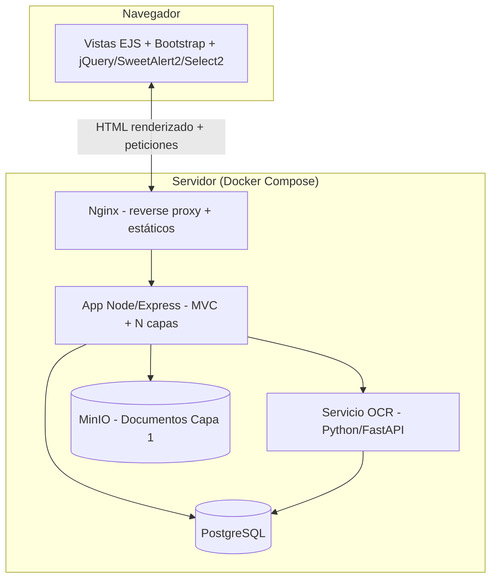

# Documento Técnico — Arquitectura y Stack Tecnológico

_Proyecto: Aplicativo Web — Escuela El Tabloncito No. 470_
_Base: Minuta de Levantamiento de Requerimientos (3 de agosto de 2026)_

## 1. Principios de diseño

- **MVC + N capas:** el backend sigue el patrón Modelo-Vista-Controlador, y dentro del "Modelo" se aplica una separación en capas (Controller → Service → Repository) para no mezclar reglas de negocio con acceso a datos.
- **Aplicación server-rendered (no SPA):** las vistas se generan en el servidor con un motor de plantillas y se sirven como HTML ya armado, apoyado con Bootstrap y jQuery para la interactividad del cliente. Esto simplifica el proyecto para un equipo de seminario: no hay que mantener una API separada del frontend ni gestionar estado de cliente complejo.
- **Layout único y reutilizable:** todas las vistas se renderizan dentro de un layout base con **header, sidebar, footer y body**, para que la navegación y la identidad visual sean consistentes en todos los módulos.
- **Modularidad por feature:** el código se organiza por dominio (`cuadros`, `alumnos`, `ocr`, `auth`), no por tipo técnico. Cualquier compañero nuevo entiende dónde está cada cosa sin explicación previa.
- **Todo en contenedores:** cero dependencias instaladas a mano en la máquina de cada integrante. Un solo `docker-compose up` levanta el entorno completo.
- **Escalable sin reescritura:** cada pieza (búsqueda, almacenamiento, OCR) puede reemplazarse por una versión más robusta más adelante cambiando configuración, no código de negocio.
- **Separación estricta de las dos capas de datos** (regla de negocio, condiciona el diseño): el documento fuente (Capa 1, válido legalmente) y el índice de metadatos (Capa 2, solo búsqueda) nunca se mezclan ni se derivan el uno del otro.

## 2. Stack tecnológico

| Componente | Tecnología | Justificación |
|---|---|---|
| Backend / Framework MVC | **Node.js + Express + TypeScript** | Express soporta motor de vistas nativamente (MVC clásico), curva de aprendizaje baja, tipado con TS reduce errores en equipo grande. |
| Motor de vistas | **EJS** | HTML plano con JS embebido; el más simple de leer/escribir para todo el equipo, ideal para armar el layout con partials (header/footer/sidebar). |
| UI / Estilos | **Bootstrap 5** + **Bootstrap Icons** + **CSS propio** | Componentes listos (navbar, sidebar, tablas, formularios), consistentes y rápidos de maquetar; CSS propio para ajustes puntuales de marca. |
| Mensajería al usuario | **SweetAlert2** | Alertas y confirmaciones (ej. "¿confirmar validación de este cuadro?") con mejor UX que un `alert()` nativo. |
| Selects mejorados | **Select2** (requiere jQuery) | Búsqueda dentro de selects largos (ej. seleccionar año, curso, código de cuadro). |
| JS de cliente | **jQuery** | Requerido por Select2; también simplifica el manejo del DOM en las vistas server-rendered. |
| Servicio de OCR | **Python + FastAPI + Tesseract (pytesseract)** | Python es el estándar de facto para OCR/IA; aislarlo en su propio servicio evita cargar el backend principal con dependencias pesadas (binarios de Tesseract, modelos). |
| Base de datos | **PostgreSQL** | Ver sección 3. |
| Almacenamiento de archivos | **MinIO** (S3-compatible) | Los escaneos (Capa 1) se guardan como objetos, no en filas de base de datos. Migración a AWS S3 en el futuro sin cambiar código (misma API S3). |
| Búsqueda | **Postgres Full-Text Search** (`tsvector`) en el MVP | Suficiente para el volumen esperado inicialmente; evita levantar un motor de búsqueda adicional antes de necesitarlo. |
| Reverse proxy | **Nginx** | Punto de entrada único; sirve estáticos (CSS/JS/imagenes) y enruta al backend. |
| Autenticación | **JWT o sesión de servidor** con roles (`admin`, `validador`, `docente`) | En una app MVC server-rendered, sesión de servidor (`express-session`) es lo más natural; JWT queda disponible si en el futuro se expone una API para consumo externo (ej. app móvil). |
| Orquestación | **Docker Compose** | Reproducibilidad total del entorno para todo el equipo. |

## 3. Por qué PostgreSQL como base de datos

- **JSONB nativo:** el "Cuadro PRIM" ha cambiado de formato con los años (ver minuta, sección 3.2). PostgreSQL permite guardar un núcleo de campos fijos (nombre, año, código) más un campo `JSONB` con los campos variables por época, sin rediseñar el esquema cada vez que aparece un formato distinto.
- **Búsqueda de texto completo integrada:** cubre el requerimiento del "motor de búsqueda avanzada" sin necesidad de Elasticsearch/Meilisearch desde el día uno.
- **Confiabilidad y madurez:** transacciones ACID, ideal para datos que tienen valor legal/administrativo (registros de alumnos, índice de cuadros).
- **Camino de escalado claro:** si el volumen o la complejidad de búsqueda crece, se agrega Meilisearch (ligero, fácil de dockerizar) alimentado desde Postgres vía triggers o un job de sincronización, sin tocar el modelo de datos original.

## 4. Diagrama de arquitectura (alto nivel)



- No hay una API separada consumida por un frontend SPA: el mismo servidor Express arma el HTML (Controller → Service → Repository → View) y lo entrega ya renderizado.
- El **servicio OCR** solo escribe en la base de datos vía su propia conexión acotada (o mediante un endpoint interno del backend), y nunca decide si un documento se guarda: eso lo confirma el flujo de validación humana desde la vista correspondiente.

## 5. Estructura de carpetas propuesta (MVC + N capas)

```
proyecto-umg/
├── docker-compose.yml
├── .env.example
├── backend/
│   ├── Dockerfile
│   ├── public/                     # estáticos servidos directo o vía Nginx
│   │   ├── css/
│   │   ├── js/
│   │   └── vendor/                 # bootstrap, sweetalert2, select2, jquery (si no se usa CDN)
│   ├── views/
│   │   ├── layouts/
│   │   │   └── main.ejs            # layout base: header + sidebar + footer + <body> (yield)
│   │   ├── partials/
│   │   │   ├── header.ejs
│   │   │   ├── sidebar.ejs
│   │   │   └── footer.ejs
│   │   ├── cuadros/
│   │   ├── alumnos/
│   │   └── auth/
│   └── src/
│       ├── controllers/            # Capa Controller (MVC)
│       │   ├── cuadros.controller.ts
│       │   ├── alumnos.controller.ts
│       │   └── auth.controller.ts
│       ├── services/                # Capa de lógica de negocio
│       │   ├── cuadros.service.ts
│       │   └── alumnos.service.ts
│       ├── repositories/            # Capa de acceso a datos
│       │   ├── cuadros.repository.ts
│       │   └── alumnos.repository.ts
│       ├── models/                  # Definición de entidades/esquemas
│       ├── routes/                  # Definición de rutas por módulo
│       ├── shared/                  # utilidades, middlewares, tipos comunes
│       └── main.ts
├── ocr-service/
│   ├── Dockerfile
│   └── app/
│       ├── main.py
│       ├── extractor/               # lógica de OCR zonal por plantilla/año
│       └── review/                  # endpoints de confianza y validación
└── infra/
    └── nginx.conf
```

**Sobre el layout:** `views/layouts/main.ejs` define la estructura común (header arriba, sidebar lateral, footer abajo, y un bloque central `<%- body %>` donde se inyecta cada vista específica). Cada módulo (`cuadros`, `alumnos`, etc.) solo necesita crear su vista de contenido — el layout se hereda automáticamente.

## 6. docker-compose — servicios previstos

| Servicio | Imagen base | Puerto interno | Notas |
|---|---|---|---|
| `nginx` | `nginx:alpine` | 80 | Sirve `public/` y enruta al backend |
| `backend` | `node:20-alpine` | 3000 | App MVC completa (vistas + lógica + API interna) |
| `ocr-service` | `python:3.12-slim` | 8000 | Requiere Tesseract instalado en la imagen |
| `postgres` | `postgres:16-alpine` | 5432 | Volumen persistente `pgdata` |
| `minio` | `minio/minio` | 9000 / 9001 | Volumen persistente `miniodata` |

> Ya no se necesita un servicio de "frontend" independiente: al ser una app server-rendered, las vistas se sirven desde el mismo contenedor `backend`.

## 7. Consideraciones no funcionales

- **Backups:** respaldo periódico del volumen de PostgreSQL y del bucket de MinIO (los documentos Capa 1 son el activo con valor legal, no se pueden perder).
- **Trazabilidad:** cada documento validado debe registrar quién lo digitalizó, quién lo validó y en qué fecha (requerimiento explícito de la minuta).
- **Portabilidad:** todo el sistema debe poder levantarse en cualquier máquina o servidor con `docker-compose up`, sin dependencias instaladas manualmente.
- **Alcance de OCR:** el pipeline se construye para una muestra piloto, no para el archivo histórico completo (ver backlog, Épica 3).
- **Librerías de cliente vía CDN o `vendor/`:** para simplificar el build, Bootstrap, Bootstrap Icons, SweetAlert2, Select2 y jQuery pueden cargarse por CDN en el layout (`main.ejs`) durante el desarrollo, y copiarse a `public/vendor/` si se necesita independencia total de internet en producción.

## 8. Próximos pasos técnicos inmediatos

1. Crear el repositorio y el esqueleto de carpetas de la sección 5.
2. Levantar `docker-compose.yml` con los servicios de la sección 6 (aunque estén vacíos al inicio).
3. Construir el layout base (`header`, `sidebar`, `footer`, `body`) con Bootstrap antes de construir cualquier vista de módulo.
4. Definir el modelo de datos de `cuadros` (Capa 1 y 2) en PostgreSQL.
5. Implementar el CRUD básico de carga y búsqueda antes de tocar el módulo de OCR.
